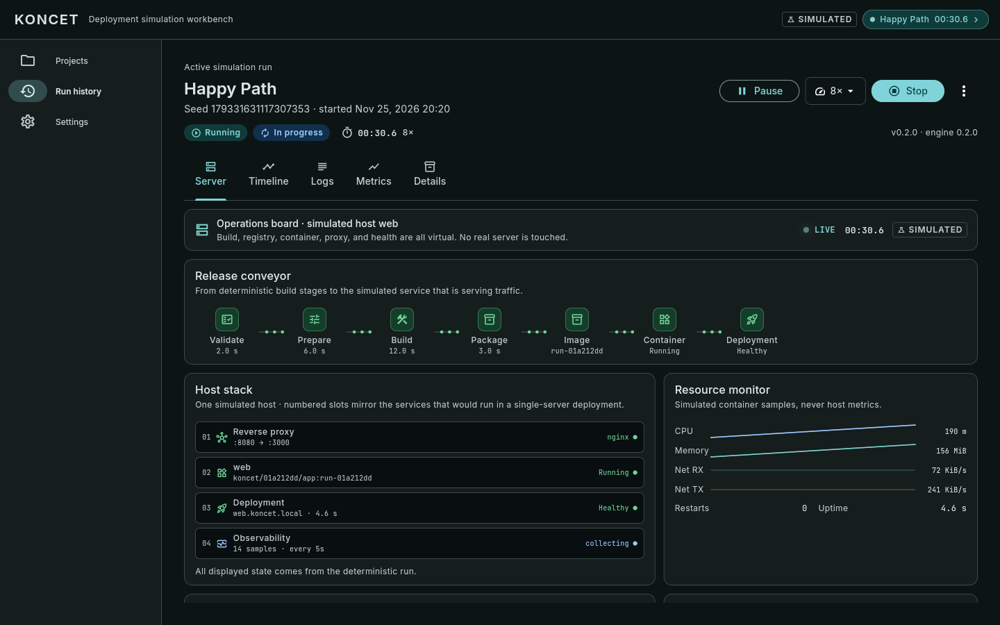
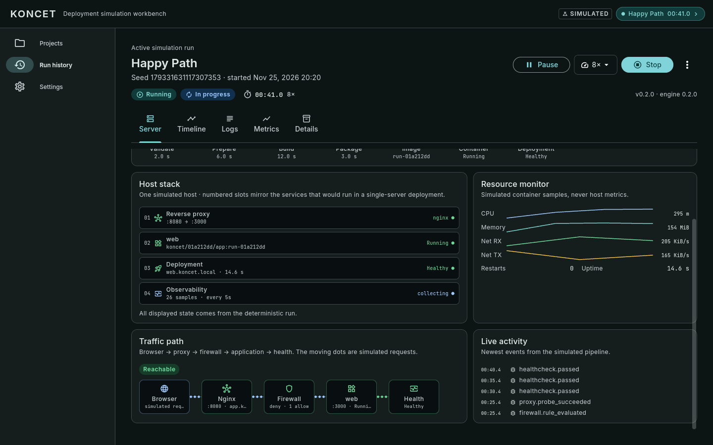
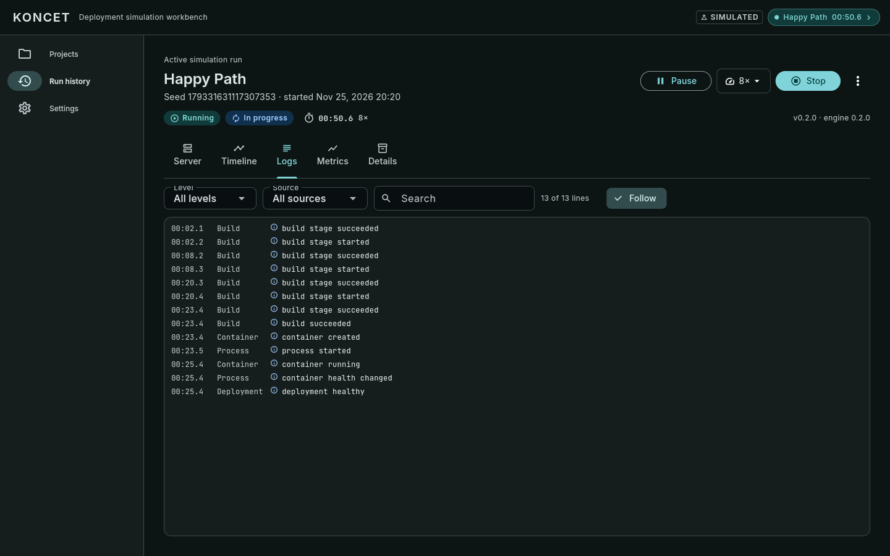
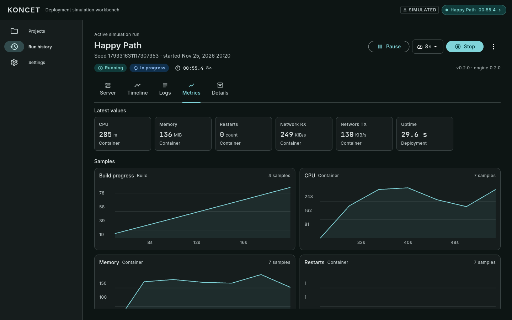
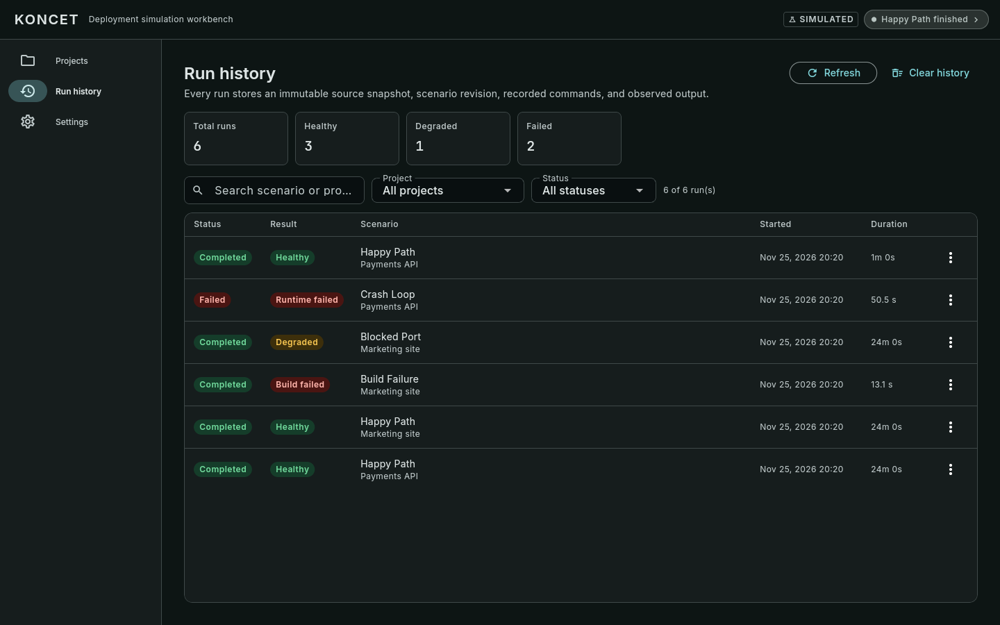
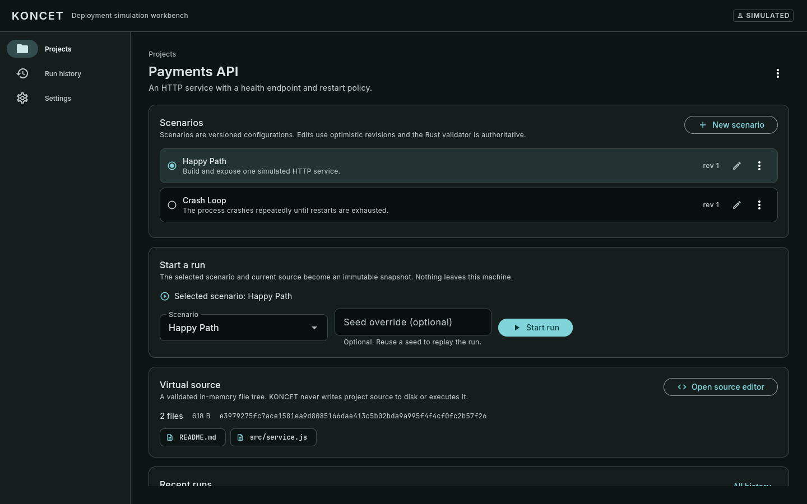

<div align="center">


# KONCET

**Kit for Operations, Network, Configuration, Environment & Testing**

A local-first deployment simulation workbench for Linux.

[](CHANGELOG.md)
[](docs/engineering/toolchain.md)
[](LICENSE)
[](docs/architecture/overview.md)

</div>

KONCET simulates the complete deployment lifecycle — source snapshot → build → image →
container → deployment → logs and monitoring — without operating Docker, Kubernetes, a real
reverse proxy, a real firewall, or any external service. Everything runs inside one desktop
application process, on a deterministic virtual clock.

> **Project status: `v0.2.0` release candidate.** The deterministic core, SQLite
> storage, Flutter↔Rust bridge, and Linux desktop loop are implemented and tested. Local
> AppImage and `.tar.gz` artifacts are built and verified; publishing is performed from a
> tagged commit through GitHub Releases.

| See | Do |
| --- | --- |
| [See it in action](#see-it-in-action) · [What you can do](#what-you-can-do) · [How it works](#how-it-works) | [Installation](#installation) · [Quick start](#quick-start) · [Build from source](#build-from-source) |

## Why KONCET

Deployment tooling is difficult to learn safely: mistakes can be expensive, environments are
hard to reproduce, and most tutorials assume a cloud account or a running daemon. KONCET makes
the full deployment loop observable, deterministic, and disposable.

- **Offline by design.** No network access at runtime, no accounts, no telemetry.
- **Deterministic.** A scenario, source snapshot, seed, and command trace reproduce the same
  event history.
- **Safe by construction.** Simulated builds and containers never execute user code or touch
  the host.
- **Small and complete.** One mature product loop instead of a shallow imitation of every
  DevOps tool.
- **Linux first.** Distributed as a desktop application from GitHub Releases.

## See it in action

<p align="center">
  
</p>
<p align="center"><em>One operations board for the whole simulated release: build stages, image, container, proxy, health, and resource samples.</em></p>

| Follow the route | Read the evidence |
| :---: | :---: |
|  <br><sub>Follow requests through the proxy and firewall. A blocked or degraded segment explains itself.</sub> |  <br><sub>Ordered, structured logs show exactly what changed and why.</sub> |
|  <br><sub>CPU, memory, network RX/TX, restarts, and uptime are sampled deterministically.</sub> |  <br><sub>Every run keeps its snapshot, command trace, result, and primary reason.</sub> |

All screenshots come from the simulated app. No real Docker daemon, proxy, firewall,
network listener, or cloud account is involved.

## What you can do

KONCET is built around the questions you ask during a real deployment:

| Question | What KONCET gives you |
| --- | --- |
| **What is happening right now?** | A live operations board with the release conveyor, simulated host stack, route, health, and resource monitor. |
| **Why did it fail?** | Build stage failures, restart exhaustion, firewall denials, proxy mistakes, health failures, and a primary reason with an explanation. |
| **Can I reproduce it?** | A source snapshot, scenario revision, seed, and recorded command trace. The same inputs replay the same deterministic run. |
| **What changed between runs?** | Immutable history with run status, result, duration, seed, logs, metrics, and the exact scenario snapshot. |
| **Can I practise safely?** | Build failures, blocked ports, crash loops, and restarts are first-class presets. Nothing touches a real host. |
| **Can I move quickly?** | Run at 1×, 2×, 4×, or 8×; pause, resume, restart, probe connectivity, and stop without waiting for real infrastructure. |
| **Where does my data live?** | A local SQLite database under XDG data, with verified backups, retention, and diagnostics. No accounts, telemetry, or network calls. |

<p align="center">
  
</p>
<p align="center"><em>Authoring stays close to the run: scenarios, the virtual source tree, and the primary Start run action live on one project page.</em></p>

## How it works

A run follows one deterministic loop:

1. **Author** a project with a virtual source tree and a versioned scenario.
2. **Start** a run. KONCET captures the source snapshot and scenario, resolves the seed, and records the run identity.
3. **Simulate** the release through build stages, an immutable image, container/process lifecycle,
   health checks, proxy/firewall probes, and metrics.
4. **Observe** the live board, timeline, logs, metrics, and details panels, then stop and reopen the
   run from history without re-running it.

The engine is local Rust on a virtual clock. Flutter is the instrument panel. SQLite is the only
persistent store. The source editor never compiles or executes your files.

## Installation

KONCET ships as a self-contained Linux desktop application. The recommended path uses the
small user-local installer: no `sudo`, package repository, account, or daemon is involved.

| Artifact | Best for |
| --- | --- |
| `KONCET-<version>-linux-x86_64.AppImage` | Recommended application bundle |
| `KONCET-<version>-linux-x86_64.tar.gz` | Systems where FUSE is unavailable or restricted |
| `install.sh` | One-command user-local install, desktop entry, and uninstall |

Download the latest assets from the project's GitHub Releases page. The examples below use
`v0.2.0`; substitute the version you downloaded.

### Requirements

- Linux **x86_64**, glibc **2.35 or newer**
- GTK 3 runtime libraries
- An X11 or Wayland session
- FUSE 2 for direct AppImage execution (otherwise use `--appimage-extract-and-run`)
- No Docker, Kubernetes, cloud account, or network connection is required

### Option A — Installer (recommended)

Download the artifact, `install.sh`, and `SHA256SUMS`, then install into `~/.local`:

```bash
chmod +x install.sh
./install.sh KONCET-0.2.0-linux-x86_64.AppImage

# Launch by name from now on:
koncet
```

If the installer is in the same directory as exactly one KONCET artifact, it can find it:

```bash
./install.sh
```

The installer verifies the release checksum, installs the application under
`~/.local/lib/koncet`, creates `~/.local/bin/koncet`, adds the icon, and writes a desktop entry
so KONCET also appears in the application menu.

Useful options:

```bash
./install.sh --prefix "$HOME/.local"       # choose another installation prefix
./install.sh --no-desktop                  # skip the application-menu entry
./install.sh --uninstall                   # remove the app; keep local data
./install.sh --latest                      # download and install the latest public release
```

`--latest` is the only installer mode that uses the network. It reads the latest public GitHub
Release, downloads the AppImage and `SHA256SUMS`, verifies them, and then replaces the installed
application. The running KONCET application itself remains completely offline. If the repository
is still private or has no release yet, the installer stops with an actionable message.

### Option B — AppImage without the installer

```bash
# 1. Verify what you received.
sha256sum -c SHA256SUMS --ignore-missing

# 2. Make it executable and launch it.
chmod +x KONCET-0.2.0-linux-x86_64.AppImage
./KONCET-0.2.0-linux-x86_64.AppImage
```

If FUSE is unavailable on your system:

```bash
./KONCET-0.2.0-linux-x86_64.AppImage --appimage-extract-and-run
```

### Option C — `.tar.gz` fallback

```bash
# 1. Verify the archive.
sha256sum -c SHA256SUMS --ignore-missing

# 2. Extract and run from the bundle directory.
tar -xzf KONCET-0.2.0-linux-x86_64.tar.gz
./KONCET-0.2.0-linux-x86_64/koncet
```

Or install the extracted bundle with the same user-local installer:

```bash
./install.sh --bundle KONCET-0.2.0-linux-x86_64
koncet
```

### First launch and local data

The first launch creates the local database and opens the Projects screen. KONCET stores all
state in the XDG data directory:

```text
${XDG_DATA_HOME:-$HOME/.local/share}/koncet
├── koncet.db          SQLite database (WAL mode)
└── backups/           verified online backups
```

The application never writes outside this directory, never sends telemetry, and never checks
for updates. A single instance owns the database writer; a stale lock after an abnormal exit is
handled by the recovery screen.

To reset all local data, close KONCET and remove that directory. **This permanently deletes
projects, scenarios, snapshots, runs, logs, metrics, settings, and backups.**

### Upgrading

Watch the repository with **Watch → Custom → Releases** to be notified when a new version is
published. Then either:

```bash
# From the installer directory
./install.sh --latest

# Or download the new artifact and install it explicitly
./install.sh KONCET-0.2.0-linux-x86_64.AppImage
```

The installer replaces the installed application while keeping local data. SQLite migrations
run automatically at startup; a verified pre-migration backup is created before a non-empty
database is migrated. An older application refuses a newer schema rather than downgrading it.

GitHub Releases is the only official distribution channel. There is no in-app auto-updater and
no background update check.

### Uninstalling

```bash
./install.sh --uninstall

# Optional: remove local application data (destructive)
rm -rf "${XDG_DATA_HOME:-$HOME/.local/share}/koncet"
```

The uninstaller removes the executable, desktop entry, and icon. Projects, runs, backups, and
settings are intentionally kept until you remove the data directory. If you installed an
AppImage or extracted bundle manually, remove that file/directory instead.

### Troubleshooting

| Symptom | Resolution |
| --- | --- |
| AppImage reports a FUSE error | Run it with `--appimage-extract-and-run`, or install FUSE 2 |
| Startup shows a lock error | Close every KONCET window. Only remove a stale lock from the recovery screen after confirming no other process is running |
| Window is too large for the desktop | Resize it once; KONCET persists window geometry and enforces a 1024×720 minimum |
| Database cannot be opened | Use **Copy diagnostics** on the recovery screen and check the data directory permissions |

## Quick start

1. **Create a project** from the Static Web or HTTP Service template.
2. **Review the virtual source tree** and the generated Happy Path scenario.
3. **Start a run**, then switch to `8×` speed to watch the deterministic build progress.
4. Follow the **build pipeline**, image promotion, container start, health checks, and
   deployment status.
5. Explore **Server**, **Timeline**, **Logs**, **Metrics**, and **Details** while the run is active.
6. **Stop** the run, then reopen it from **Run history** to see the immutable snapshot and
   recorded command trace.

Everything is simulated. The `.koncet.local` endpoint and every port are virtual.

## What KONCET simulates

| Area | Simulated behaviour |
| --- | --- |
| Project management | Projects, virtual source trees, templates, snapshots |
| Source code | Editing and validation only; nothing is compiled or executed |
| Build process | Staged, deterministic builds with logs and injected failures |
| Container image | Immutable local images with layers, tags, digests, and size |
| Container engine | Create, start, stop, restart, remove, resource settings, state transitions |
| Process manager | Supervised app process, restart policy, backoff, crash loops |
| Reverse proxy | Virtual host/path routes and deterministic connectivity checks |
| Firewall | Virtual allow/deny rules with observable consequences |
| Deployment status | Pending, deploying, healthy, degraded, failed, stopped |
| Logs and monitoring | Structured logs, event timeline, CPU/memory/network samples, health |

Hostnames use the reserved `.koncet.local` suffix and all ports are virtual.

## Stack

| Layer | Choice |
| --- | --- |
| Desktop UI | Flutter, Dart, Material 3 |
| Core engine and persistence | Rust |
| UI ↔ core boundary | In-process FFI via `flutter_rust_bridge` |
| Local database | SQLite (WAL mode) |
| Target platform | Linux x86_64, glibc 2.35+ |
| Distribution | GitHub Releases: AppImage (primary) and `.tar.gz` |
| Licence | GPL-3.0-or-later |

The rationale and rejected alternatives are recorded in [Architecture decisions](docs/architecture/adr/README.md)
and [Stack selection](docs/architecture/stack.md). Verified toolchain versions are listed in
[Toolchain versions](docs/engineering/toolchain.md).

## Build from source

### Run from a checkout

After the one-time toolchain setup below, a fresh checkout runs with one command:

```bash
git clone <repository-url> KONCET
cd KONCET
./run.sh
```

`run.sh` checks the toolchain, fetches Dart dependencies, then launches the Linux app. It does
not require `just` or `flutter_rust_bridge_codegen` because the generated bridge is committed.

```bash
./run.sh --check      # verify Rust, Flutter, native headers, and GTK 3
./run.sh              # development launch
./run.sh --release    # build the release bundle and launch it
./run.sh --install    # build and install as ~/.local/bin/koncet
./run.sh --help
```

### Prerequisites

- Rust **1.85+** (1.100.0 verified)
- Flutter **3.50.x** stable with Dart **3.14**
- CMake, Ninja, Clang, `pkg-config`
- GTK 3, X11, and Xi development headers
- Python 3 for the SBOM generator and release tooling
- `curl` if packaging needs to download `appimagetool`
- `just` and `flutter_rust_bridge_codegen` **2.13.0** only for maintainer tasks and codegen

<details>
<summary><strong>Debian / Ubuntu</strong></summary>

```bash
sudo apt update
sudo apt install -y build-essential clang cmake ninja-build pkg-config \
  libgtk-3-dev libx11-dev libxi-dev python3 curl git
```

</details>

<details>
<summary><strong>Fedora</strong></summary>

```bash
sudo dnf install -y clang cmake ninja-build pkgconf-pkg-config \
  gtk3-devel libX11-devel libXi-devel python3 curl git
```

</details>

<details>
<summary><strong>Arch Linux</strong></summary>

```bash
sudo pacman -S --needed base-devel clang cmake ninja pkgconf \
  gtk3 libx11 libxi python curl git
```

</details>

### Install the toolchain

```bash
# Rust (if not already installed)
curl --proto '=https' --tlsv1.2 -sSf https://sh.rustup.rs | sh
source "$HOME/.cargo/env"

# Flutter: install 3.50.x stable, then put it on PATH.
export PATH="$HOME/.local/share/flutter/bin:$PATH"
flutter --version
flutter config --enable-linux-desktop

# Maintainer tooling (optional for simply running the app)
cargo install just --locked
cargo install flutter_rust_bridge_codegen --version 2.13.0 --locked
```

### Regenerate the bridge

The generated bridge (`apps/desktop/lib/src/rust`, `crates/koncet-ffi/src/frb_generated.rs`)
is committed, so running KONCET never needs codegen. After changing the FFI surface:

```bash
just codegen
just codegen-check
```

### Build release artifacts

```bash
# Without just:
./scripts/build-release.sh
./scripts/package-linux.sh

# Or with the maintainer recipes:
just build-release
just package

ls -lh dist/
```

`package-linux.sh` downloads `appimagetool` on first use unless `APPIMAGETOOL` points to a
local binary. Release artifacts must be rebuilt from a clean tagged commit on the documented
Ubuntu 22.04 baseline before publishing.

## Development

```bash
just check            # format, clippy, Rust tests, Dart analyze/tests
just e2e              # Linux end-to-end journey
just codegen-check    # fail if generated bridge output is stale
just package          # release artifacts
```

| Command | Purpose |
| --- | --- |
| `./run.sh` | Launch from a checkout without requiring `just` |
| `./run.sh --check` | Verify the source-run toolchain |
| `./run.sh --install` | Build and install as `~/.local/bin/koncet` |
| `just bootstrap` | Fetch Rust and Dart dependencies |
| `just fmt` | Format Rust and Dart sources |
| `just fmt-check` | Verify formatting without modifying files |
| `just clippy` | Run Clippy with warnings denied |
| `just rust-test` | Run the Rust workspace test suite |
| `just dart-analyze` | Analyze the Flutter app and design system |
| `just dart-test` | Run Dart unit/controller/theme tests |
| `just e2e` | Run the Linux desktop integration journey |
| `just screenshots` | Seed demo runs and regenerate the README showcase at 1440×900 |
| `just run` | Launch the app in development mode |
| `just version-check` | Verify all manifests agree on `VERSION` |

## Repository layout

```text
KONCET/
├── apps/desktop/          Flutter Linux desktop application
│   ├── lib/               presentation, routing, Riverpod state
│   ├── integration_test/  Linux end-to-end journey
│   ├── linux/             native runner + Rust cdylib build
│   └── packaging/         AppImage/desktop/icon assets
├── crates/                Rust workspace
│   ├── koncet-domain/     Pure domain model and state machines
│   ├── koncet-sim/        Deterministic simulation engine
│   ├── koncet-storage/    SQLite migrations and repositories
│   ├── koncet-app/        Use cases, orchestration, event fan-out
│   └── koncet-ffi/        flutter_rust_bridge API surface
├── packages/koncet_ui/    Shared Material 3 design system
├── .github/workflows/     Linux CI and tagged release automation
├── docs/                  Product, architecture, design, engineering, project
├── scripts/               Version, codegen, packaging, and SBOM tooling
├── run.sh                One-command source launcher
├── install.sh            User-local installer and uninstaller
├── VERSION               Single product version
├── justfile              Developer and release recipes
├── flutter_rust_bridge.yaml
├── CHANGELOG.md
├── CONTRIBUTING.md
├── LICENSE
└── SECURITY.md
```

This is a monorepo with **one product version**. The repository is the only release unit; there
are no independently published packages.

## Documentation

Start at the [documentation index](docs/README.md).

| Audience | Start here |
| --- | --- |
| Product and scope | [PRD](docs/product/prd.md) · [Use cases](docs/product/use-cases.md) · [Roadmap](docs/product/roadmap.md) |
| Engineering | [Architecture](docs/architecture/overview.md) · [Simulation engine](docs/architecture/simulation-engine.md) · [Data model](docs/architecture/data-model.md) |
| Design | [Design system](docs/design/design-system.md) · [Screens and flows](docs/design/screens-and-flows.md) |
| Delivery | [Monorepo](docs/engineering/monorepo.md) · [Workflow](docs/engineering/development-workflow.md) · [Release](docs/engineering/release-and-distribution.md) |
| Toolchain | [Verified toolchain versions](docs/engineering/toolchain.md) |
| Implementation | [Phase 1 plan](docs/project/phase-1-plan.md) |

## Simulation boundary

KONCET is inspired by real deployment concepts but is not an emulator of a specific product.
It does not:

- execute source code or run real build tools;
- create namespaces, cgroups, virtual machines, or OS-level containers;
- bind ports, modify `nftables`/`iptables`, or configure a host proxy;
- call GitHub, container registries, cloud APIs, or any network endpoint;
- read or write files outside its own application data directory;
- send telemetry or check for updates.

The UI labels simulated environments explicitly. Product wording must always distinguish
KONCET's models from real infrastructure.

## Security and contributing

- Security policy and private reporting: [SECURITY.md](SECURITY.md)
- Contribution workflow, commit conventions, and review expectations: [CONTRIBUTING.md](CONTRIBUTING.md)
- Every change must keep documentation, tests, migrations, and generated bindings in sync.

## Licence

Copyright © 2026 KONCET contributors.

Licensed under the [GNU General Public License v3.0 or later](LICENSE). If you distribute a
modified binary, you must make the corresponding source available under the same licence.
