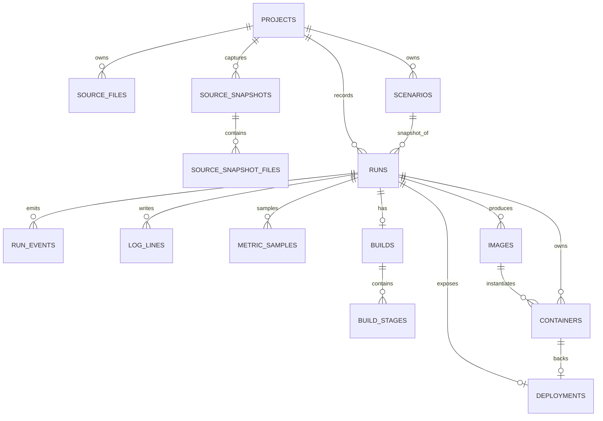

# Data and Persistence Model

> **Status:** Baseline · **Applies to:** `v0.1.0`, schema version 1  
> **Last updated:** 2026-11-24  
> **Related:** [Domain model](domain-model.md) · [Desktop bridge](desktop-bridge.md) · [Security](security.md)

## 1. Storage principles

- **SQLite is the only durable store** for projects, source, scenarios, runs, events, logs,
  metrics, and settings.
- **One writer, many readers.** WAL mode; the DB writer thread serialises writes; reads use
  read-only connections and never block the UI isolate.
- **Explicit migrations.** Embedded, ordered SQL migrations with checksums. No ORM
  auto-migration.
- **History is append-only.** Runs, events, logs, and metrics are not edited in place.
- **Everything important is reproducible.** A run stores full snapshots of its inputs,
  versions, seed, and command trace.
- **Bounded growth.** Per-run caps and user-visible storage controls.

## 2. Application data locations

XDG conventions are used on Linux:

| Path (default) | Contents |
| --- | --- |
| `$XDG_DATA_HOME/koncet/koncet.db` (`~/.local/share/koncet`) | Main database |
| `.../koncet/backups/` | Manual and pre-migration backups |
| `.../koncet/.lock` | Single-instance lock |
| `$XDG_STATE_HOME/koncet/logs/` (`~/.local/state/koncet`) | Application diagnostics only |
| `$XDG_CACHE_HOME/koncet/` | Non-critical render/code-editor caches |

Rules:

- Application data directory is created with mode `0700`; database and backups `0600`.
- The runtime writes nowhere else. Source projects are virtual and never exported implicitly.
- The app never follows symlinks inside its data directory for managed files.
- Simulation logs are **not** files; they are rows in SQLite. Diagnostics are separate and
  never mixed with product data.

## 3. Connection configuration

```sql
PRAGMA journal_mode = WAL;
PRAGMA foreign_keys = ON;
PRAGMA busy_timeout = 5000;
PRAGMA synchronous = NORMAL;
PRAGMA temp_store = MEMORY;
PRAGMA trusted_schema = OFF;
```

- `synchronous=NORMAL` is appropriate for a local interactive app with WAL; explicit
  checkpoints occur on pause, stop, backup, and graceful shutdown.
- `foreign_keys` is enabled on every connection, not just migrations.
- Read connections are query-only where supported.
- `wal_autocheckpoint` stays at the SQLite default unless benchmarks justify a change.

## 4. What is stored where

| Product concept | Tables |
| --- | --- |
| Project | `projects`, `source_files` |
| Scenario / configuration | `scenarios` (versioned JSON plus revision), `app_settings` (application preferences) |
| Simulation history | `runs`, `run_events`, `run_commands`, `builds`, `build_stages`, `images`, `containers`, `deployments`, `log_lines`, `metric_samples` |
| Immutable run inputs | `source_snapshots`, `source_snapshot_files`, `runs.scenario_snapshot_json`, `runs.seed` |
| Local configuration | `app_settings` keys such as `theme_mode`, `default_speed`, `active_project_id`, `window_geometry`, and `last_backup_at` |

`app_settings` contains only non-secret, user-level preferences. No credentials, tokens, host
paths, or machine fingerprints are stored.

## 5. Entity relationship overview



The logical cardinality above is the `v0.1` contract; several relationships are intentionally
not enforced by unique constraints so later releases can add multi-build or multi-service
runs without rebuilding tables.

`runs.seed` is stored as a decimal `TEXT` value rather than `INTEGER` so the full non-negative
63-bit range survives SQLite and every bridge representation without sign or precision loss.
The application validates the canonical decimal form and converts it to `u64` in the domain.

## 6. Schema (v1)

> This DDL matches migration 1, embedded in `koncet-storage`. It is the baseline
> contract for `v0.1.0`; later changes append migrations and update this section.
> `runs.scenario_id` and `runs.source_snapshot_id` are required and use the default
> `NO ACTION` foreign-key behaviour: a scenario or snapshot that appears in history cannot
> be deleted on its own, while deleting the owning project cascades both sides in one
> statement.

```sql
CREATE TABLE schema_migrations (
    version    INTEGER PRIMARY KEY,
    name       TEXT NOT NULL,
    checksum   TEXT NOT NULL,
    applied_at INTEGER NOT NULL
) STRICT;

CREATE TABLE projects (
    id            TEXT PRIMARY KEY,
    name          TEXT NOT NULL CHECK (length(trim(name)) BETWEEN 1 AND 80),
    description   TEXT NOT NULL DEFAULT '' CHECK (length(description) <= 500),
    template_id   TEXT NOT NULL,
    created_at    INTEGER NOT NULL,
    updated_at    INTEGER NOT NULL,
    archived_at   INTEGER
) STRICT;

CREATE TABLE source_files (
    project_id    TEXT NOT NULL REFERENCES projects(id) ON DELETE CASCADE,
    path          TEXT NOT NULL,
    language      TEXT NOT NULL,
    content       TEXT NOT NULL,
    byte_size     INTEGER NOT NULL CHECK (byte_size >= 0),
    created_at    INTEGER NOT NULL,
    updated_at    INTEGER NOT NULL,
    PRIMARY KEY (project_id, path)
) STRICT;

CREATE TABLE source_snapshots (
    id            TEXT PRIMARY KEY,
    project_id    TEXT NOT NULL REFERENCES projects(id) ON DELETE CASCADE,
    content_hash  TEXT NOT NULL,
    file_count    INTEGER NOT NULL CHECK (file_count >= 0),
    total_bytes   INTEGER NOT NULL CHECK (total_bytes >= 0),
    created_at    INTEGER NOT NULL
) STRICT;
CREATE INDEX idx_snapshots_project ON source_snapshots(project_id, created_at DESC);

CREATE TABLE source_snapshot_files (
    snapshot_id   TEXT NOT NULL REFERENCES source_snapshots(id) ON DELETE CASCADE,
    path          TEXT NOT NULL,
    language      TEXT NOT NULL,
    content       TEXT NOT NULL,
    byte_size     INTEGER NOT NULL CHECK (byte_size >= 0),
    PRIMARY KEY (snapshot_id, path)
) STRICT;

CREATE TABLE scenarios (
    id             TEXT PRIMARY KEY,
    project_id     TEXT NOT NULL REFERENCES projects(id) ON DELETE CASCADE,
    name           TEXT NOT NULL CHECK (length(trim(name)) BETWEEN 1 AND 80),
    description    TEXT NOT NULL DEFAULT '' CHECK (length(description) <= 500),
    schema_version INTEGER NOT NULL CHECK (schema_version > 0),
    revision       INTEGER NOT NULL DEFAULT 1 CHECK (revision > 0),
    config_json    TEXT NOT NULL,
    created_at     INTEGER NOT NULL,
    updated_at     INTEGER NOT NULL,
    UNIQUE (project_id, name)
) STRICT;
CREATE INDEX idx_scenarios_project ON scenarios(project_id, updated_at DESC);

CREATE TABLE runs (
    id                      TEXT PRIMARY KEY,
    project_id              TEXT NOT NULL REFERENCES projects(id) ON DELETE CASCADE,
    scenario_id             TEXT NOT NULL REFERENCES scenarios(id),
    scenario_name           TEXT NOT NULL,
    scenario_schema_version INTEGER NOT NULL CHECK (scenario_schema_version > 0),
    scenario_snapshot_json  TEXT NOT NULL,
    source_snapshot_id      TEXT NOT NULL REFERENCES source_snapshots(id),
    seed                    TEXT NOT NULL,
    app_version             TEXT NOT NULL,
    engine_version          TEXT NOT NULL,
    status                  TEXT NOT NULL CHECK (status IN
                              ('running','paused','completed','cancelled','failed')),
    result                  TEXT NOT NULL CHECK (result IN
                              ('healthy','degraded','build_failed','runtime_failed','unknown')),
    started_at              INTEGER NOT NULL,
    ended_at                INTEGER,
    sim_duration_ms         INTEGER NOT NULL DEFAULT 0 CHECK (sim_duration_ms >= 0),
    last_event_seq          INTEGER NOT NULL DEFAULT 0 CHECK (last_event_seq >= 0),
    end_reason              TEXT,
    summary_json            TEXT
) STRICT;
CREATE INDEX idx_runs_project ON runs(project_id, started_at DESC);
CREATE INDEX idx_runs_history ON runs(started_at DESC, id DESC);

CREATE TABLE run_events (
    run_id         TEXT NOT NULL REFERENCES runs(id) ON DELETE CASCADE,
    seq            INTEGER NOT NULL CHECK (seq > 0),
    sim_time_ms    INTEGER NOT NULL CHECK (sim_time_ms >= 0),
    wall_time_ms   INTEGER NOT NULL,
    category       TEXT NOT NULL,
    event_type     TEXT NOT NULL,
    severity       TEXT NOT NULL CHECK (severity IN ('debug','info','warn','error')),
    source         TEXT NOT NULL,
    payload_json   TEXT NOT NULL,
    schema_version INTEGER NOT NULL DEFAULT 1 CHECK (schema_version > 0),
    PRIMARY KEY (run_id, seq)
) STRICT;
CREATE INDEX idx_events_type ON run_events(run_id, event_type, seq);

CREATE TABLE run_commands (
    run_id        TEXT NOT NULL REFERENCES runs(id) ON DELETE CASCADE,
    seq           INTEGER NOT NULL CHECK (seq > 0),
    sim_time_ms   INTEGER NOT NULL CHECK (sim_time_ms >= 0),
    command_json  TEXT NOT NULL,
    PRIMARY KEY (run_id, seq)
) STRICT;

CREATE TABLE builds (
    id              TEXT PRIMARY KEY,
    run_id          TEXT NOT NULL REFERENCES runs(id) ON DELETE CASCADE,
    ordinal         INTEGER NOT NULL CHECK (ordinal > 0),
    profile         TEXT NOT NULL,
    status          TEXT NOT NULL CHECK (status IN
                      ('queued','running','succeeded','failed','cancelled')),
    image_id        TEXT,
    started_sim_ms  INTEGER,
    finished_sim_ms INTEGER,
    failure_json    TEXT,
    created_at      INTEGER NOT NULL,
    UNIQUE (run_id, ordinal)
) STRICT;
CREATE INDEX idx_builds_run ON builds(run_id, ordinal);

CREATE TABLE build_stages (
    build_id        TEXT NOT NULL REFERENCES builds(id) ON DELETE CASCADE,
    ordinal         INTEGER NOT NULL CHECK (ordinal > 0),
    name            TEXT NOT NULL,
    status          TEXT NOT NULL CHECK (status IN
                      ('pending','running','succeeded','failed','skipped')),
    planned_ms      INTEGER NOT NULL CHECK (planned_ms > 0),
    started_sim_ms  INTEGER,
    finished_sim_ms INTEGER,
    failure_json    TEXT,
    PRIMARY KEY (build_id, ordinal)
) STRICT;

CREATE TABLE images (
    id              TEXT PRIMARY KEY,
    run_id          TEXT NOT NULL REFERENCES runs(id) ON DELETE CASCADE,
    build_id        TEXT NOT NULL REFERENCES builds(id) ON DELETE CASCADE,
    repository      TEXT NOT NULL,
    tag             TEXT NOT NULL,
    digest          TEXT NOT NULL CHECK (length(digest) = 71 AND substr(digest, 1, 7) = 'sha256:'),
    size_bytes      INTEGER NOT NULL CHECK (size_bytes >= 0),
    layers_json     TEXT NOT NULL,
    profile         TEXT NOT NULL,
    source_hash     TEXT NOT NULL,
    engine_version  TEXT NOT NULL,
    created_sim_ms  INTEGER NOT NULL CHECK (created_sim_ms >= 0)
) STRICT;
CREATE INDEX idx_images_run ON images(run_id);

CREATE TABLE containers (
    id                TEXT PRIMARY KEY,
    run_id            TEXT NOT NULL REFERENCES runs(id) ON DELETE CASCADE,
    image_id          TEXT NOT NULL REFERENCES images(id) ON DELETE CASCADE,
    name              TEXT NOT NULL,
    state             TEXT NOT NULL CHECK (state IN
                        ('created','starting','running','stopping','stopped','failed','removed')),
    health            TEXT NOT NULL CHECK (health IN
                        ('unknown','starting','healthy','unhealthy')),
    restart_count     INTEGER NOT NULL DEFAULT 0 CHECK (restart_count >= 0),
    config_json       TEXT NOT NULL,
    process_json      TEXT NOT NULL,
    created_sim_ms    INTEGER NOT NULL,
    started_sim_ms    INTEGER,
    stopped_sim_ms    INTEGER,
    exit_code         INTEGER,
    failure_reason    TEXT,
    UNIQUE (run_id, name)
) STRICT;
CREATE INDEX idx_containers_run ON containers(run_id);

CREATE TABLE deployments (
    id                   TEXT PRIMARY KEY,
    run_id               TEXT NOT NULL REFERENCES runs(id) ON DELETE CASCADE,
    image_id             TEXT NOT NULL,
    container_id         TEXT NOT NULL REFERENCES containers(id) ON DELETE CASCADE,
    service_name         TEXT NOT NULL,
    status               TEXT NOT NULL CHECK (status IN
                           ('pending','deploying','healthy','degraded','failed','stopped')),
    health               TEXT NOT NULL CHECK (health IN
                           ('unknown','starting','healthy','unhealthy')),
    primary_reason       TEXT,
    revision             INTEGER NOT NULL DEFAULT 1 CHECK (revision > 0),
    uptime_ms            INTEGER NOT NULL DEFAULT 0 CHECK (uptime_ms >= 0),
    healthy_since_sim_ms INTEGER,
    created_sim_ms       INTEGER NOT NULL,
    updated_sim_ms       INTEGER NOT NULL
) STRICT;
CREATE INDEX idx_deployments_run ON deployments(run_id);

CREATE TABLE log_lines (
    id           INTEGER PRIMARY KEY AUTOINCREMENT,
    run_id       TEXT NOT NULL REFERENCES runs(id) ON DELETE CASCADE,
    seq          INTEGER NOT NULL CHECK (seq > 0),
    sim_time_ms  INTEGER NOT NULL CHECK (sim_time_ms >= 0),
    source       TEXT NOT NULL,
    level        TEXT NOT NULL CHECK (level IN ('debug','info','warn','error')),
    message      TEXT NOT NULL,
    context_json TEXT,
    UNIQUE (run_id, seq)
) STRICT;
CREATE INDEX idx_logs_run_time ON log_lines(run_id, id);
CREATE INDEX idx_logs_run_level ON log_lines(run_id, level, id);
CREATE INDEX idx_logs_run_source ON log_lines(run_id, source, id);

CREATE TABLE metric_samples (
    run_id       TEXT NOT NULL REFERENCES runs(id) ON DELETE CASCADE,
    entity_type  TEXT NOT NULL,
    entity_id    TEXT NOT NULL,
    metric       TEXT NOT NULL,
    sim_time_ms  INTEGER NOT NULL CHECK (sim_time_ms >= 0),
    value        REAL NOT NULL,
    unit         TEXT NOT NULL,
    PRIMARY KEY (run_id, entity_type, entity_id, metric, sim_time_ms)
) STRICT;

CREATE TABLE app_settings (
    key         TEXT PRIMARY KEY,
    value_json  TEXT NOT NULL,
    updated_at  INTEGER NOT NULL
) STRICT;
```

Migration bookkeeping lives in `schema_migrations`, created by the initial migration. The runner
verifies every applied checksum and refuses to continue if a migration was altered. Because the
checksum covers the whole migration text, editing an applied migration is never allowed.

## 7. Indexing and query strategy

- Projects: ordered by `updated_at DESC`; archived filtered with an index added if needed.
- History: `idx_runs_history` supports newest-first; project filters use
  `idx_runs_project`. Pagination uses keyset `(started_at, id)`, not deep offsets.
- Timeline: events by `seq`; filters by type use the compound index.
- Logs: paginate by `id`, newest first for tail; text search is a bounded `LIKE` over the
  selected run/filters in `v0.1`. FTS5 is deferred until benchmarks justify it.
- Metrics: query by run/entity/metric and time range; downsample in Rust before sending to UI.
- Settings: tiny key-value table; typed accessors validate JSON.

All query APIs accept bounded limits. The default page size is 200, maximum 1,000.

## 8. Write and transaction model

| Operation | Transaction boundary |
| --- | --- |
| Create project | Project + template files + baseline scenario in one transaction |
| Start run | Snapshot files, snapshot row, run row, initial event in one transaction |
| Engine event | Append event and update `last_event_seq` in the same transaction |
| Recorded command | Append with a contiguous sequence in the same transaction as its effects |
| Log/metric batch | Single transaction per batch (up to 250 ms), ordered inserts |
| State snapshot tables | Upsert build/stage/image/container/deployment at their change boundaries |
| Finalise run | Final status, result, summary, duration, end reason in one transaction |
| Delete project/run | Single cascading delete; foreign keys enabled |

Domain events are persisted before UI publication. Logs and metrics may lose at most the
current unflushed batch on a hard crash; they are flushed on pause, stop, and graceful
shutdown.

## 9. Migrations

- Schema version starts at 1. Migrations are append-only, numbered, and embedded in the
  binary.
- Startup sequence: acquire single-instance lock → open DB → integrity/quick check → read
  applied versions → if upgrade needed, create and verify backup → run each migration in a
  transaction → verify foreign keys → checkpoint.
- A migration failure rolls back, keeps the backup, and shows a recovery screen with the
  diagnostic path. The app must not continue with a partial schema.
- Downgrades are unsupported. An older app refuses a newer schema and explains how to
  restore the pre-migration backup.
- Every supported version transition has a fixture-based migration test.

## 10. Retention and deletion

| Data | Default policy |
| --- | --- |
| Projects | Kept until deleted; archiving preserves data |
| Runs | Kept until deleted; history ordered newest first |
| Events | Kept with run; cap guard 100,000 per run, treated as fatal integrity limit |
| Logs | Cap 25,000 per run; truncation event at cap |
| Metrics | Sample interval default 5 s; maximum 1,000 points per series query; stored until run deletion |
| Application diagnostics | Daily rolling, 7 files, outside SQLite |
| Backups | Manual backups keep the newest 5; the newest pre-migration backup is kept; user can delete |

Settings MAY offer “delete runs older than…” in a later release. `v0.1` exposes storage usage
and explicit deletion only. Deleting data does not require `VACUUM`; an optional maintenance
action may run `PRAGMA incremental_vacuum` when free pages exceed a threshold.

## 11. Backup and recovery

- Backup uses `VACUUM INTO` to a timestamped file named
  `koncet-{manual|pre-migration}-{epoch_ms}.db` in `backups/`, then runs
  `PRAGMA integrity_check` on the copy. A failed verification deletes the copy and aborts.
- Keep the last 5 successful manual backups plus the latest pre-migration backup. Pruning runs
  after every manual backup and after startup.
- Restore is a documented manual procedure in `v0.1`: close KONCET, replace the database
  with a verified backup, relaunch. A restore UI is deferred.
- On open, `PRAGMA quick_check(1)` detects obvious corruption. On failure, show a recovery screen,
  preserve the file, and do not attempt destructive repair.
- The single-instance lock prevents two writers. The lock records the PID and a random token;
  stale locks are detected by PID liveness on `/proc`. A stale lock is removed only when the
  caller opts in (`break_stale_lock`) after explicit user confirmation.

## 12. Data safety rules

- No raw SQL from UI; all statements are parameterised in `koncet-storage`.
- JSON columns are validated on write and treated as untrusted on read.
- Paths never reach the host filesystem; only the database path is real.
- Logs and scenario text are rendered as text, never HTML.
- Backups and DB are user-private files; no encryption is promised in `v0.1` (rely on OS disk
  encryption if needed).
- Database schema and migration checksums are included in diagnostics, never sensitive data.
