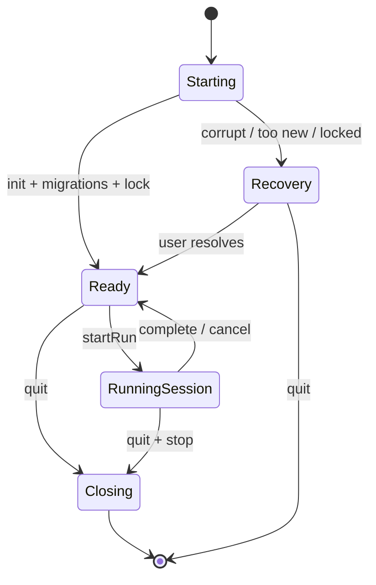

# Desktop Bridge and Runtime Integration

> **Status:** Baseline · **Applies to:** `v0.1.0`  
> **Last updated:** 2026-11-24  
> **Related:** [Architecture overview](overview.md) · [Simulation engine](simulation-engine.md) · [Data model](data-model.md)

## 1. Decision

The Flutter UI and Rust core run in **one Linux process**. Dart calls Rust through generated
`flutter_rust_bridge` v2 bindings to a `cdylib`. There is no HTTP server, WebSocket, Unix
socket, child process, or daemon.

This provides low latency, no port conflicts, no extra lifecycle, and a single artifact. The
trade-off is a compiled native dependency and generated bindings; both are contained by a
walking skeleton and contract tests.

## 2. Module boundaries

```text
apps/desktop (Dart)
  screens / widgets
  riverpod providers
  generated bridge bindings
        │  async commands + typed streams
        ▼
crates/koncet-ffi
  #[frb] facade, DTO mapping, batch scheduling,
  panic containment, error codes
        │
        ▼
crates/koncet-app
  use cases, session manager, persistence ordering
        │                 │
        ▼                 ▼
koncet-sim            koncet-storage
        ▼                 ▼
           koncet-domain
```

Dart never imports Rust implementation details. Rust never returns database rows or internal
aggregate objects; the FFI layer maps to versioned DTOs.

## 3. Threading and async rules

| Work | Executor | Rules |
| --- | --- | --- |
| UI rendering and input | Flutter UI isolate | No synchronous FFI calls; no SQL; no file I/O |
| Commands and queries | FRB worker pool | `async` Rust functions; bounded and cancellable where sensible |
| Simulation ticks | Dedicated engine thread | Only owner of mutable session state |
| Writes | Dedicated DB writer thread | Single SQLite writer; batch transactions |
| Reads | Bounded read pool | Read-only connections; paginated queries |
| Logging | Non-blocking diagnostic layer | Separate from simulation logs |

- The UI must not receive a promise that blocks the raster/UI thread. Long queries are paged.
- One active `RunSession` exists at most. Starting another returns a typed conflict.
- The engine owns its thread; dropping the Flutter route does **not** stop the run.
- On quit, the app asks the core to stop or finish the active run, drains output, checkpoints
  SQLite, then exits.
- A panic in Rust is caught at the FFI boundary and returned as `Internal`; it must never
  unwind into Dart.

## 4. API shape

Names below are illustrative; generated names may follow FRB conventions. They define the
required surface, not final signatures.

### 4.1 Bootstrap and settings

```text
initApp() -> AppInfo
getSettings() -> Settings
updateSettings(patch: SettingsPatch) -> Settings
getDataUsage() -> DataUsage
createBackup() -> BackupInfo
getDiagnosticsInfo() -> DiagnosticsInfo
```

`AppInfo` includes app version, engine version, schema version, build commit, and platform.
Initialisation failures carry an actionable code (for example `db_locked`, `db_corrupt`,
`schema_too_new`) for a dedicated recovery screen.

### 4.2 Projects and source

```text
listProjects(query: ProjectQuery) -> Page<ProjectSummary>
getProject(id) -> ProjectDetail
createProject(input: CreateProjectInput) -> ProjectDetail
renameProject / updateProject / archiveProject / deleteProject
duplicateProject(id) -> ProjectDetail
listTemplates() -> TemplateCatalog
getSourceTree(projectId) -> SourceTree
readSourceFile(projectId, path) -> SourceFile
writeSourceFile(projectId, path, content) -> SourceFile
createSourceFile / renameSourceFile / deleteSourceFile
validateSource(projectId) -> ValidationReport
```

Autosave is a UI responsibility: debounce ~500–800 ms, show saved state, and surface
validation without blocking typing. Writes are validated again by Rust.

### 4.3 Scenarios

```text
listScenarios(projectId) -> [ScenarioSummary]
getScenario(id) -> ScenarioDetail
createScenario / updateScenario / duplicateScenario / deleteScenario
validateScenario(input) -> ValidationReport
getScenarioPresets() -> [Preset]
```

The canonical scenario is stored as versioned JSON; UI form models may be generated or mapped,
but the Rust validator is authoritative.

### 4.4 Runs and sessions

```text
startRun(projectId, scenarioId, seed?: string) -> RunHandle
listRuns(filter: RunFilter) -> Page<RunSummary>
getRun(runId) -> RunDetail
deleteRun(runId) -> void
pauseRun(runId) / resumeRun(runId) / setSpeed(runId, speed)
stopRun(runId) -> RunSummary
restartContainer(runId) / startContainer(runId) / stopContainer(runId)
runConnectivityCheck(runId) -> ConnectivityResult
subscribeSession(runId) -> Stream<SessionFrame>
subscribeLogs(runId, filter) -> Stream<LogBatch>
subscribeMetrics(runId, filter) -> Stream<MetricBatch>
```

`startRun` captures snapshots, inserts the run, and returns once durable. The UI then
subscribes; the session stream includes the current snapshot so a late subscriber catches up.

### 4.5 Historical reads

```text
getRunDetail(runId) -> RunDetail
getRunEvents(runId, page) -> Page<EventView>
getRunLogs(runId, filter, page) -> Page<LogView>
getRunMetrics(runId, filter) -> MetricSeries
getRunBuild(runId) / getRunImage(runId) -> ...
getRunRuntime(runId) -> RuntimeSnapshot
```

Historical reads never instantiate the engine and never mutate the run.

## 5. Streams and frames

To avoid rebuilding the UI on every 100 ms tick, the bridge exposes:

1. **`SessionFrame`** — a compact snapshot of the live run (status, clock, build stages,
   container, deployment, route, primary reason) plus new timeline events since the last
   sequence. Maximum ~20 fps.
2. **`LogBatch`** — ordered log records, up to N records / 100 ms. Display-only; backpressure
   may coalesce but never reorder.
3. **`MetricBatch`** — samples appended since the previous batch, at most one per series per
   sampling interval.

Every frame and batch carries `run_id` and sequence/watermark fields. Dart drops duplicates
and never applies out-of-order frames. A subscription failure leaves the active run intact and
shows a non-destructive reconnect state.

Event payloads and DTOs are append-only compatible:

- add optional fields; never repurpose fields;
- UI ignores unknown fields and renders unknown event types as a generic timeline entry;
- persisted payloads carry a schema version;
- breaking changes require a new event type or schema version plus migration tests.

## 6. DTO and error conventions

- DTOs use explicit integer widths and ISO-8601 strings for wall timestamps where Dart benefits;
  simulation time is a 64-bit integer of milliseconds.
- Seeds travel as decimal strings to preserve 63-bit values without JavaScript ambiguity.
- Enums are closed in `v0.1`, but event `type` is a namespaced string for forward compatibility.
- Errors contain `code`, `message`, `target`, `retryable`, and `diagnostic_id`. They never
  include SQL, host paths, or stack traces.
- Domains errors are mapped centrally in `koncet-ffi`; a missing mapping fails a contract test.

Example error codes: `validation_failed`, `active_run_exists`, `run_not_active`,
`invalid_run_transition`, `db_busy`, `corrupt_data`, `lock_held`, `lock_stale`,
`schema_too_new`, `not_initialised`, `internal_error`.

## 7. Lifecycle



- Startup: single-instance lock → open/migrate DB → reconcile interrupted runs → expose app.
- Active run navigation: session continues; navbar shows an active indicator.
- Quit with an active run: modal choices “Stop run and quit”, “Return”, and, if safe,
  “Keep running in background” is **not** supported in `v0.1` because the process exits.
- Abrupt termination: next startup marks `running`/`paused` rows `cancelled` with
  `app_terminated`; logs/metrics keep the last flushed data.
- Theme and window geometry are stored through settings; the initial window must appear before
  data loading, with skeleton content.

## 8. UI state ownership

- Riverpod providers own selection, filters, forms, and subscription lifecycle.
- Server/core state is represented by immutable DTOs from the bridge; UI should not duplicate
  simulation rules.
- A `RunSessionController` subscribes to the three streams, merges frame/log/metric state, and
  exposes selectors so only relevant widgets rebuild.
- Form validation is immediate locally for UX, but the Rust validator decides acceptance.
- No engine-derived status is computed independently in Dart. Display labels/icons map from
  core-provided enums and reason codes.

## 9. FFI safety checklist

1. All exported calls validate DTOs and return typed errors; no `unwrap()` reachable with
   untrusted input.
2. No `unsafe` outside the generated bridge and vetted dependencies.
3. Panics are caught at the boundary; diagnostic id is logged with context.
4. Large data is paged or streamed; no unbounded allocations proportional to database size.
5. Rust API uses a single composition root; tests can inject in-memory storage and a fake clock.
6. Generated bindings are committed and regenerated deterministically; CI verifies no drift.
7. A smoke test starts the app headlessly (or with `xvfb-run`) and exercises init → project →
   run start/stop → query.

## 10. Implemented surface for `v0.1.0`

The generated Dart entry points live in `apps/desktop/lib/src/rust/`. Rust wrappers in
`crates/koncet-ffi/src/api.rs` remain the reviewed boundary; screen code depends on the thin
`KoncetApi` façade in `apps/desktop/lib/src/bridge/api.dart`.

Implemented command groups:

| Group | Functions |
| --- | --- |
| Bootstrap | `initApp(allowStaleLock)`, `initAppAt(dataRoot, allowStaleLock)`, `shutdownApp`, `getAppInfo` |
| Projects | `listTemplates`, `listProjects`, `getProject`, `getSourceTree`, `readSourceFile`, `createProject`, `renameProject`, `setProjectDescription`, `archiveProject`, `unarchiveProject`, `deleteProject`, `duplicateProject`, source file create/rename/delete/write, `validateSource` |
| Scenarios | `listScenarioPresets`, `listScenarios`, `getScenario`, `createScenario`, `updateScenario`, `duplicateScenario`, `deleteScenario`, `validateScenario`, `canonicalScenarioJson` |
| Runs | `startRun`, `advanceSession`, pause/resume/speed/stop/cancel, `restartContainer`, `checkConnectivity`, `getActiveRunId`, `getActiveFrame`, `getRun` |
| History | `listRunHistory`, `countRuns`, `deleteRun`, `deleteRunHistory`, `getRunEvents`, `countRunEvents`, run logs and metrics queries, `getSourceSnapshot` |
| Settings/system | settings JSON list/get/set/delete, `getDataUsage`, backup create/list/delete, `checkIntegrity`, `quickCheck`, `getDiagnosticsInfo` |
| Streams | `subscribeSessionStream`, `subscribeLogsStream`, `subscribeMetricsStream` |

Implementation notes:

- IDs cross as UUID strings, seeds as decimal strings, wall time as epoch milliseconds, and
  simulation time as 64-bit milliseconds. Structured event payloads, log context, settings
  values, and scenario documents cross as JSON strings.
- Closed status vocabularies are generated Dart enums (`RunStatusDto`, `DeploymentStatusDto`,
  and so on); event `type` remains a namespaced string.
- `SessionFrameDto` carries the complete compact frame, new events, a watermark sequence, and
  a `finalised` flag. Log and metric batches also carry `finalised`; the forwarding thread
  closes the Dart stream after that item.
- A late session subscriber receives the current frame first. The controller deduplicates
  events/logs/metrics by sequence so a command response and a ticker frame can overlap
  without duplicating UI data.
- Only one active `RunSession` exists. Commands return `run_not_active` when called from a
  different process or after finalisation.
- `advanceSession` exists for deterministic UI tests; the normal desktop flow uses the Rust
  ticker at 100 ms wall-clock resolution and applies the selected speed.
- First-run migration, stale/live lock errors, corruption, and schema-too-new failures all
  map to `BridgeError` codes and drive the recovery screen. Panics are caught by `guard` and
  returned as `internal_error` with a diagnostic id.
- `run_commands` are persisted atomically with the effects of the command. The finalised run
  detail exposes the command trace for replay-oriented inspection.
