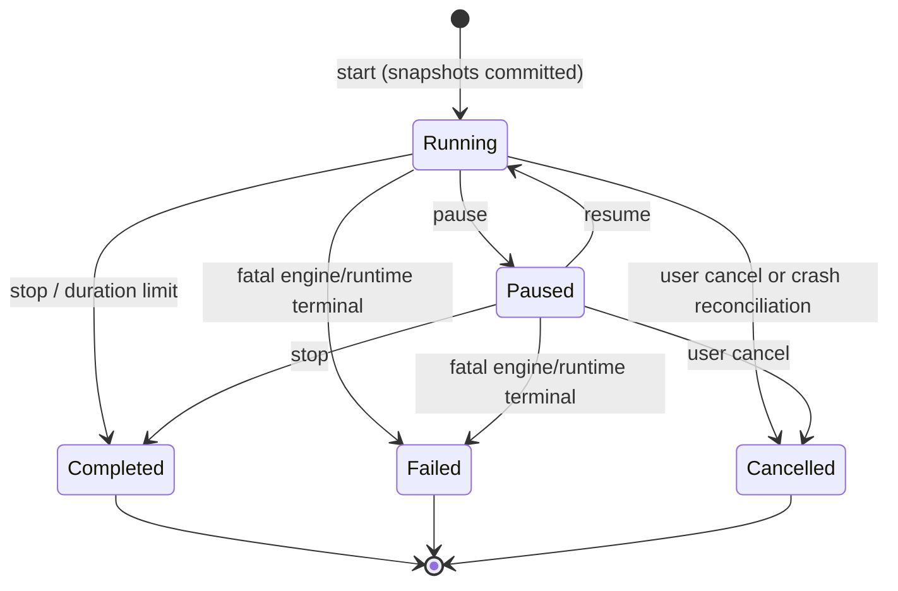
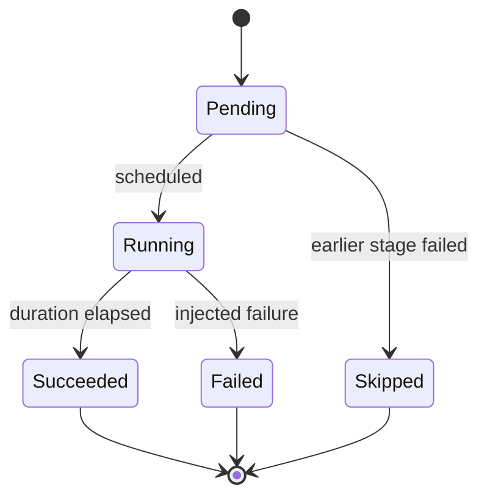
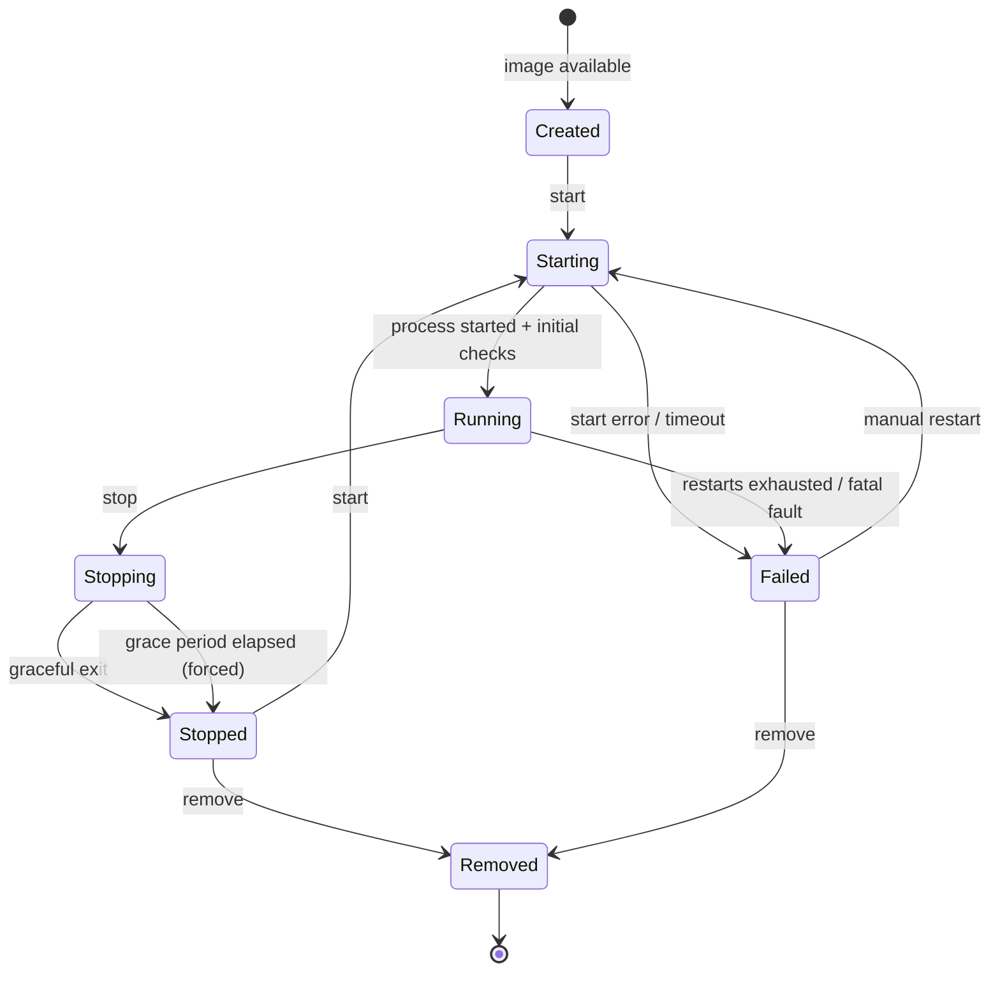
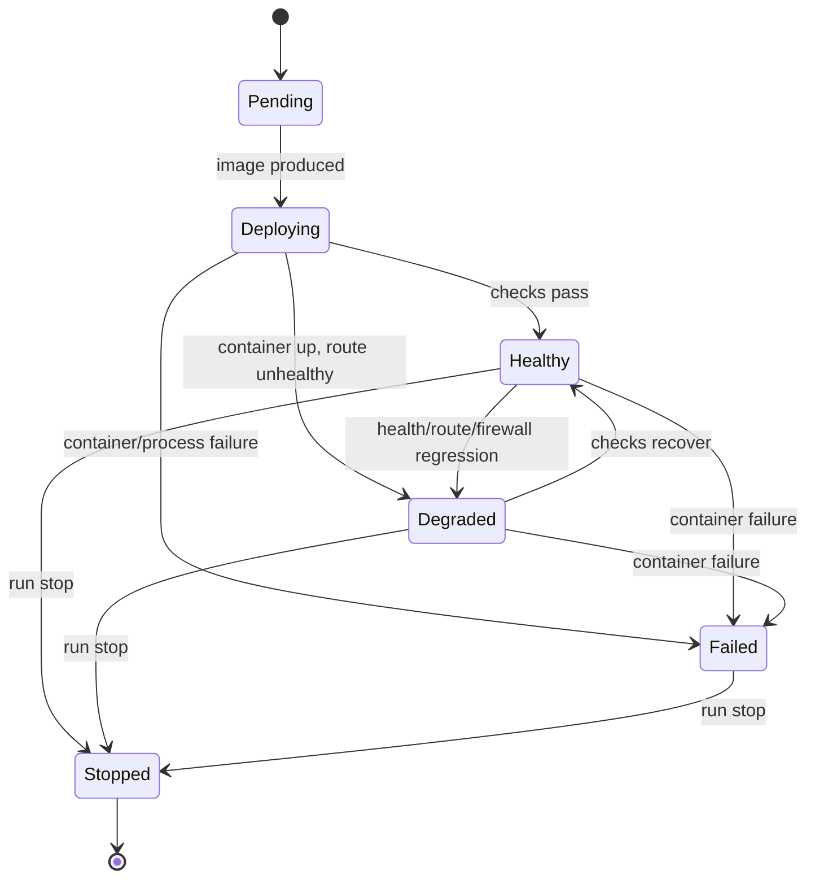

# Domain Model

> **Status:** Baseline · **Applies to:** `v0.1.0`  
> **Last updated:** 2026-11-24  
> **Related:** [Simulation engine](simulation-engine.md) · [Data model](data-model.md) · [Glossary](../reference/glossary.md)

## 1. Modelling principles

- The domain is expressed in pure Rust types with constructors that enforce invariants.
- Identifiers are UUIDv7 values. User-visible names are not identifiers and may change.
- Simulation time (`SimTime`), wall time (`TimestampUtc`), and durations are distinct types;
  they are never represented by untyped integers in domain APIs.
- State changes go through methods returning typed domain errors; persistence stores results,
  not intentions.
- A historical run is immutable. Live runtime objects belong to the active session; persisted
  snapshots are read models.

## 2. Aggregates

### 2.1 Project

Root entity for authoring data.

| Field | Rules |
| --- | --- |
| `id` | UUIDv7, immutable |
| `name` | 1–80 characters after trim; duplicates allowed but discouraged; user can resolve |
| `description` | ≤ 500 characters |
| `template_id` | Known template at creation; informational afterwards |
| `created_at`, `updated_at` | UTC timestamps |
| `archived_at` | Optional; archived projects are read-only for authoring |

Invariants:

- A project owns a virtual source tree and zero or more scenarios.
- Archiving blocks edits and new runs but preserves history and allows unarchive.
- Deletion is explicit, confirmed, and cascades to owned runs, snapshots, scenarios, logs,
  metrics, and events.
- Project name changes never mutate image repository identifiers or historical records.

### 2.2 Source tree

A set of `SourceFile` records with relative POSIX paths.

- Paths are normalised, relative, use `/`, contain no `.`/`..` segments, no empty segments,
  no leading slash, and no NUL. Maximum depth 16.
- Directories are derived, not stored.
- Allowed text files only; binary content is out of scope. Maximum file size 256 KiB,
  maximum 200 files, maximum total 5 MiB.
- One required entrypoint per build profile is validated at run start.
- Editing is autosaved; every run captures a `SourceSnapshot` containing all files and a
  SHA-256 content hash independent of edit order.

### 2.3 Scenario

Versioned configuration aggregate owned by a project.

- Immutable once a run starts; edits create a new revision of the stored scenario.
- `schema_version` is mandatory; unknown future versions are rejected; older supported
  versions are migrated on load in a future release.
- Validation is pure and shared by UI messages and run start.
- Scenarios may be duplicated; duplicates receive new IDs and a copy suffix.
- Deleting a scenario does not alter historical runs because each run stores a full scenario
  snapshot.

### 2.4 Source snapshot

Immutable value object/entity created at run start.

- Contains every file's path, language hint, content, content hash, and byte count.
- Stable content hash: SHA-256 over canonical JSON of sorted `(path, content)` entries.
- Snapshots are never garbage-collected while any run references them; cascade on project
  delete.

### 2.5 Simulation run

Aggregate root for one execution.

| Field | Meaning |
| --- | --- |
| `id` | UUIDv7 |
| `seed` | 63-bit non-negative integer |
| `source_snapshot_id` | Immutable input |
| `scenario_snapshot` | Canonical JSON + schema version |
| `status` | `running`, `paused`, `completed`, `cancelled`, `failed` |
| `result` | `healthy`, `degraded`, `build_failed`, `runtime_failed`, `unknown` |
| `started_at`, `ended_at` | Wall time metadata |
| `sim_duration_ms` | Simulated duration |
| `last_event_seq` | Monotonic sequence integrity |
| `summary` | Final counts and primary reason |
| `app_version`, `engine_version` | Compatibility context |

Rules:

- Exactly one run may be active in `v0.1`; this is an application-level invariant.
- A run starts only after snapshots and metadata are durably written.
- Only `running` can accept commands. Paused runs accept control commands only.
- Terminal status never transitions again.
- Final state and summary are immutable after finalisation.
- A crash-interrupted run is reconciled to `cancelled` with `app_terminated`; it is not
  resumed.

### 2.6 Build

Child entity of a run.

- `BUILD-01..04` stage ordering is fixed in `v0.1`.
- Every stage has `pending|running|succeeded|failed|skipped`.
- On first failure, remaining stages become `skipped`.
- No image may reference a failed or cancelled build.
- A successful build produces exactly one image in `v0.1`.

### 2.7 Simulated image

Immutable entity.

- Repository must match `[a-z0-9][a-z0-9._/-]*`; tag must match a restricted OCI-like tag
  pattern; both are display-level because no registry exists.
- Digest is a full lowercase `sha256:` hex string computed from the canonical image
  manifest; it is conceptually content-addressed but explicitly simulated.
- Layers are ordered and immutable. Layer size and total size are deterministic integers.
- Tags are metadata; an image cannot be mutated or retagged in place in `v0.1`.
- Images are run-scoped in `v0.1`; a project-wide library is deferred.

### 2.8 Container

Runtime child entity, one per deployment in `v0.1`.

| Field | Notes |
| --- | --- |
| `id`, `run_id`, `image_id` | Immutable references |
| `name` | Unique within the run; safe slug |
| `state` | See state machine |
| `health` | `unknown`, `starting`, `healthy`, `unhealthy` |
| `restart_count` | Monotonic non-negative |
| `config` | Resource limits, env, port, restart policy, health check |
| `exit_code` | Optional; simulated |
| `failure_reason` | Stable reason code when failed |

Validation before creation:

- CPU between 50 and 4,000 millicores; memory between 32 MiB and 4 GiB.
- Env keys match `[A-Z_][A-Z0-9_]*`, max 50 entries, value ≤ 4 KiB; total config ≤ 64 KiB.
- Exposed virtual ports 1–65535; one port in `v0.1`.
- Port conflicts with proxy listener or other simulated sockets are rejected.
- Health-check interval 1–60 s, timeout < interval, retries 1–10.

### 2.9 Process

Simulated supervised process inside a container.

- Attempt count and restart timestamps in simulated time.
- The command string is inert display data.
- Exit may be normal (`0`) or failure (non-zero), or caused by a deterministic fault.
- Restart policy exhaustion moves the container to `FAILED`; logs explain why.
- A process is never shared across containers.

### 2.10 Deployment

Read-mostly aggregate describing the service exposed by a run.

- Exactly one deployment per successful build in `v0.1`.
- Links run, image, container, route, and firewall context via the scenario snapshot.
- Status and primary reason are derived from child subsystem state at a tick boundary, then
  persisted as a change event only when different.
- Uptime is accumulated in simulated time while `HEALTHY`; stopping freezes it.

### 2.11 Event and log records

- Domain events are append-only, ordered per run, and immutable.
- `seq` starts at 1, increments by one, and gaps are integrity errors.
- Logs are ordered by an insert identifier and simulated time; they carry a domain source.
- Metrics are samples keyed by run, entity, metric, and simulation timestamp.
- None of these records may be edited in place.

## 3. State machines

### 3.1 Run



`result` is independent: a completed run may be `healthy`, `degraded`, or `build_failed`
(if the operator allowed observation after failure). `v0.1` defaults to stop-on-terminal
failure but supports observing a degraded endpoint until the user stops.

### 3.2 Build stage



### 3.3 Container



Forced removal from `Running` is prohibited in the model; stop first. This keeps audit
history comprehensible.

### 3.4 Deployment status



`PENDING` when no image exists yet; on build failure the deployment is not created and the
run result is `build_failed`.

## 4. Status derivation

```text
if image absent and build failed       -> run.result = build_failed, no deployment
if container.state in {failed, removed} -> deployment = FAILED
if container.state in {created, stopping, stopped} while run active -> STOPPED or FAILED
if container.state in {starting}        -> DEPLOYING
if container.state == running:
    if app health != healthy or route != reachable -> DEGRADED
    else -> HEALTHY
```

Primary reasons (stable codes): `build_failed`, `image_missing`, `container_failed`,
`restart_exhausted`, `healthcheck_failed`, `route_unreachable`, `firewall_denied`,
`proxy_misconfigured`, `user_stopped`, `app_terminated`.

## 5. Typed errors

Domain errors are exhaustive enums with stable codes and human messages supplied by the UI
layer. Categories:

- `Validation` — field/path/reference problems with a target for inline display.
- `Conflict` — illegal state transition, active run already exists, duplicate key.
- `NotFound` — missing entity; must not reveal internals.
- `Constraint` — limits (file count, log cap, size).
- `Persistence` — storage failure; retryable flag where applicable.
- `Internal` — invariant violation; logged with context, never a panic across FFI.

Errors carry no secrets or host paths. UI maps codes to localised copy; fallback displays a
safe generic message with a copyable diagnostic id.

## 6. Identifier and naming rules

- IDs: lowercase hyphenated UUIDv7 strings in APIs and SQLite `TEXT`.
- Container names: lowercase slug, 3–40 chars, unique within a run.
- Image repository: local-looking namespace (for example `koncet/demo`) but never resolved
  remotely; UI shows “local simulated image”.
- Hostnames: lowercase DNS label + `.koncet.local`; no external TLD.
- Stable reason and event type strings are `snake_case` with dot namespaces
  (`container.failed`, `firewall_denied`).

## 7. Invariants worth testing

1. A terminal run cannot be mutated or resumed.
2. No event sequence has duplicates or gaps.
3. A failed build never produces an image or deployment.
4. A deployment cannot be `HEALTHY` unless container is running, process healthy, route
   reachable, and firewall allows the probe.
5. A container cannot be removed while running.
6. Restart count never decreases; restart schedule is monotonic in simulated time.
7. Source snapshot content is unchanged when the project is edited afterwards.
8. Project deletion leaves no orphaned rows in any owned table.
9. Log truncation never removes domain events.
10. Running the same golden inputs twice produces identical canonical event/log/metric
    output.
