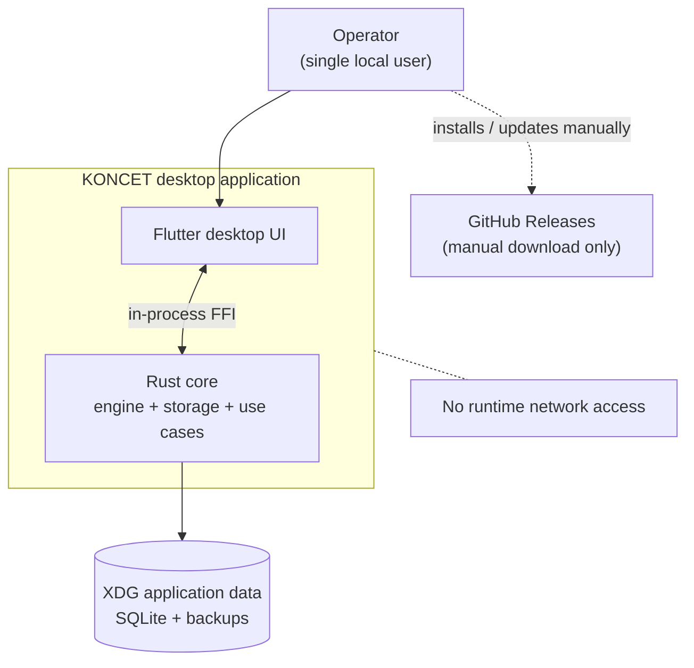
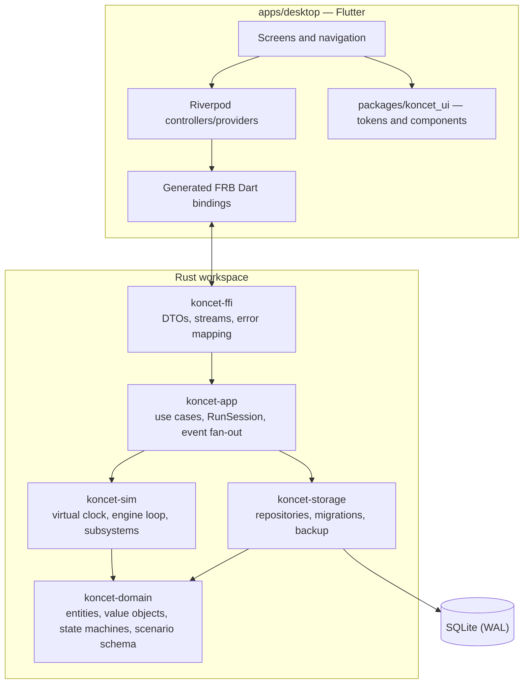

# Architecture Overview

> **Status:** Baseline · **Applies to:** `v0.1.0`  
> **Last updated:** 2026-11-24  
> **Related:** [Stack](stack.md) · [Simulation engine](simulation-engine.md) · [Domain model](domain-model.md) · [Desktop bridge](desktop-bridge.md)

## 1. Architectural intent

KONCET is a **single-process, local-first desktop simulator**. A Flutter UI renders a
Material 3 workbench; an embedded Rust core owns simulation correctness, persistence, and
long-running work. The process performs no network I/O and executes no user code.

The architecture optimises for:

1. **Deterministic behaviour** — one owner of simulation state, virtual time, seeded random
   streams, and an append-only event history.
2. **A responsive UI** — no database or engine work on Flutter's UI isolate.
3. **Clear boundaries** — pure domain and engine crates, SQLite isolated behind
   repositories, FFI as a thin typed adapter.
4. **Long-term evolution** — versioned scenarios, events, and database migrations.

## 2. System context



There is no server tier, account service, remote database, or background agent. The only
external interaction in the product lifecycle is the user manually downloading a release.

## 3. Layers and containers



### Responsibilities

| Component | Owns | Must not |
| --- | --- | --- |
| `apps/desktop` | Presentation, navigation, ephemeral view state, design-system use | Contain engine rules, SQL, or direct filesystem writes |
| `packages/koncet_ui` | Theme tokens, shared widgets, status semantics, component goldens | Import app/domain logic or perform I/O |
| `koncet-ffi` | Stable FRB API, DTO mapping, stream/batching, panic containment, error codes | Implement business rules |
| `koncet-app` | Use cases, active-session lifecycle, persistence ordering, subscriptions | Contain UI concerns or expose rows directly |
| `koncet-sim` | Virtual time, event loop, simulated subsystems, deterministic RNG | Touch the filesystem, network, system clock, or SQLite |
| `koncet-storage` | Schema, migrations, transactions, queries, backup, retention | Decide product rules |
| `koncet-domain` | Types, invariants, state machines, canonical identifiers, scenario/event schemas | Perform I/O or depend on Flutter |

Dependency direction is strictly:

```text
koncet-ffi → koncet-app → { koncet-sim, koncet-storage } → koncet-domain
```

`koncet-sim` and `koncet-storage` never depend on each other. There are no cycles. This is
enforced by Cargo's dependency graph and an architecture test that forbids I/O crates in
`domain` and `sim`.

## 4. Runtime view

```mermaid
sequenceDiagram
    participant UI as Flutter UI
    participant FFI as koncet-ffi
    participant App as koncet-app
    participant Sim as koncet-sim
    participant DB as koncet-storage

    UI->>FFI: startRun(command)
    FFI->>App: validate + map DTO
    App->>DB: capture snapshots + insert run
    App->>Sim: create session(run inputs)
    App-->>UI: RunHandle
    UI->>FFI: subscribeSession(runId)
    loop virtual ticks / batched frames
        Sim-->>App: domain events, logs, metric samples
        App->>DB: append events; batch logs/metrics
        App-->>UI: RunView + log/metric batches
    end
    UI->>FFI: pause / speed / stop
    FFI->>App: command with sim timestamp
    App->>Sim: enqueue command
    Sim-->>App: final state
    App->>DB: finalise summary, flush, checkpoint
```

### Process and thread model

| Executor | Work |
| --- | --- |
| Flutter UI isolate | Rendering, gestures, navigation, keyboard; consumes streams and sends commands only |
| FRB worker pool | Async command handlers and queries; never blocks the UI isolate |
| **Engine thread** (one) | Owns mutable simulation state and advances ticks; sole producer of engine events |
| **DB writer thread** (one) | Serialises writes and transactions; SQLite single-writer rule |
| Read pool | Bounded read-only WAL connections for history and log queries |

Only one run may be active in `v0.1`. The active session survives navigation but not process
exit; abrupt termination is reconciled at next startup. Details are in
[Desktop bridge](desktop-bridge.md).

## 5. Key data flows

### 5.1 Start run

1. UI sends `StartRun(projectId, scenarioId, seed?)`.
2. `koncet-app` validates the project, scenario schema, source constraints, and absence of
   another active run.
3. It captures an immutable source snapshot and the canonical scenario snapshot.
4. It inserts the run with app/engine versions and seed, then starts the engine session.
5. The engine emits events, logs, and metrics. Domain events are appended to SQLite before
   being published to the UI; logs and metrics are batched for throughput and flushed on
   pause, stop, and shutdown.

### 5.2 User command

Commands (pause, speed, restart container, connectivity check) are timestamped at the
current simulation tick and recorded in the command trace. This makes interactive runs
reproducible and ensures every final state has an explanation.

### 5.3 Historical view

History uses only SQLite. It never starts the engine. Stored snapshots and events are read
and rendered read-only; unknown fields/types from older versions degrade gracefully.

## 6. Persistence architecture

- One SQLite database in the XDG data directory; WAL mode, foreign keys, strict tables.
- Migrations are embedded, ordered, transactional, and preceded by a verified backup.
- UUIDv7 text identifiers; UTC integer milliseconds for wall time; simulation time in
  integer milliseconds and stored separately.
- Scenario and event payloads are versioned JSON, canonicalised for hashing and golden tests.
- Deleting a project cascades to all owned data after confirmation.
- See [Data model](data-model.md) for schema and retention policy.

## 7. Security architecture

The central safety property is **non-execution**: project files are inert text, builds are
simulated, and the four infrastructure components are software models. There are no shells,
sockets, namespaces, or host firewall mutations. Input validation, FFI panic containment,
path confinement, database permissions, dependency licensing, and offline verification are
covered in [Security](security.md).

## 8. Quality attributes

| Attribute | Design response |
| --- | --- |
| Determinism | Single engine thread, virtual clock, seeded independent RNG streams, stable map ordering, canonical JSON, golden runs |
| Responsiveness | Batched UI updates (max ~20 Hz), virtualised lists, SQLite off UI thread, no blocking FFI, downsampled metrics |
| Reliability | WAL, transactions, pre-migration backup, graceful drain, single-instance lock, startup reconciliation |
| Maintainability | Five Rust crates with one-way dependencies, design-system package, typed bridge, ADRs, docs-as-contract |
| Testability | Pure domain/sim crates, scripted command traces, in-memory SQLite, golden fixtures, widget/golden tests |
| Portability | Linux first; platform-specific code confined to Flutter shell and packaging; no OS-specific engine logic |
| Privacy | Offline, no telemetry, all data local under user-controlled directories |
| Accessibility | Central design tokens, semantic status mapping, keyboard-first controls, contrast and scaling gates |

## 9. Explicit architecture constraints

1. No real provisioning or execution APIs in shipping crates.
2. No network client/server, IPC socket, or localhost server.
3. Domain and simulation crates remain I/O-free.
4. FFI exposes use cases and read models, not internal entities or SQL rows.
5. The UI never fabricates simulation state. If the core cannot initialise, it shows a fatal
   recovery screen with diagnostics rather than fake data.
6. Simulation and real infrastructure never share identifiers, screens, or commands in a
   way that implies real effects. UI labels use “Simulated”.

## 10. Decomposition map

| Document | Covers |
| --- | --- |
| [Simulation engine](simulation-engine.md) | Clock, loop, subsystems, determinism, monitoring models |
| [Domain model](domain-model.md) | Aggregates, state machines, invariants, status derivation |
| [Data model](data-model.md) | Tables, relationships, migrations, retention, backup |
| [Desktop bridge](desktop-bridge.md) | FFI API, DTOs, streams, errors, threading, lifecycle |
| [Security](security.md) | Threat model and controls |
| [Design system](../design/design-system.md) | Visual language and components |
