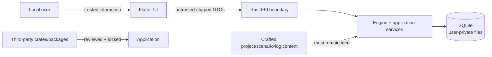

# Security and Privacy Model

> **Status:** Baseline · **Applies to:** `v0.1.0`  
> **Last updated:** 2026-11-24  
> **Related:** [PRD NFRs](../product/prd.md#9-non-functional-requirements) · [Desktop bridge](desktop-bridge.md) · [SECURITY.md](../../SECURITY.md)

## 1. Safety property

The primary security claim is stronger than “we validate input”: **KONCET has no execution
surface for user content.** Project files are inert text. Builds, containers, processes,
proxies, and firewalls are models inside a Rust process. There is no shell, compiler,
interpreter, container runtime, network socket, or OS policy mutation in the product runtime.

The assets to protect are:

1. the host filesystem outside KONCET's XDG data directory;
2. the integrity and confidentiality of local project/run data;
3. the integrity of the application binary and its supply chain;
4. the user's understanding that the environment is simulated.

## 2. Trust boundaries

- The local user is trusted to access their own data, but **content** is untrusted.
- The OS account boundary is trusted; KONCET does not promise protection from a compromised
  local account or malware with equivalent privileges.
- Third-party dependencies are untrusted until reviewed and pinned.
- Linux, Flutter, GLib/GTK, and the dynamic linker are platform dependencies outside the
  product's control.

## 3. Threat model and controls

| Threat | Example | Controls |
| --- | --- | --- |
| Arbitrary code execution | A crafted “source file” or scenario is executed | No interpreter/compiler/process API; architecture tests ban `std::process::Command` in shipping crates; inert commands only displayed |
| Path traversal / host write | Virtual path `../../.ssh/authorized_keys` | Normalised relative virtual paths; reject `.`/`..`, absolute paths, NUL; no mapping from virtual path to real path |
| SQL injection | Crafted project name or filter | Parameterised statements only; no string-built SQL; typed repository APIs |
| FFI memory safety / panic | Malformed DTO or engine bug crosses FFI | Generated bridge, no ad-hoc `unsafe`, catch panics, typed errors, fuzz/contract tests, no panics in production paths |
| Denial of service by data volume | 1 GB log or 1,000,000 files | Hard caps: file size/count/total, log cap, event guard, bounded channels, paged queries, UI virtualisation |
| Malicious display content | Control characters or bidi overrides in logs | Store/sanitise text; render as plain text; strip control chars where harmful; no HTML/WebView in v0.1 |
| Local data exposure | Other users reading DB | `0700` data dir, `0600` files; data stays under user's XDG dirs; optional OS disk encryption recommendation |
| Backups leaking | Backup copied or world-readable | Backups created with `0600`; UI shows path; no cloud upload |
| Dependency compromise | Malicious crate/plugin | Lockfiles committed, review new deps, `cargo-deny`, Dart licence/advisory checks, minimal dependency set |
| Network exfiltration | Telemetry or update check | No networking dependencies in shipping code; smoke test via `strace`; no auto-update, analytics, remote assets, or web fonts |
| Licence contamination | GPL-incompatible dependency | Allowlist of licences; automated checks; third-party notices; release gate |
| User misunderstands simulation | Believes a real firewall was changed | Persistent “Simulated” labelling, `.koncet.local` hosts, no real ports, copy review; onboarding copy states limits |
| Schema downgrade / corruption | New DB opened by old app | Refuse newer schema; verified pre-migration backup; no automatic destructive repair |

## 4. Runtime controls

### 4.1 Filesystem

- The application creates/uses only:
  - `~/.local/share/koncet/` for database, backups, lock;
  - `~/.local/state/koncet/` for diagnostics;
  - `~/.cache/koncet/` for disposable caches.
- No arbitrary file picker or import/export in `v0.1`.
- Source, scenarios, and logs never touch the host filesystem except as SQLite rows.
- Managed paths are constructed from fixed XDG roots; names are not user-controlled.
- Symlink handling: do not traverse links inside managed data directories; use atomic writes
  and restrictive permissions for new files.
- The database and backups use least-privilege modes (`0600`), directories `0700`.

### 4.2 No network

- Shipping crates do not depend on HTTP/TLS/DNS/socket libraries; Flutter plugins with
  networking must be explicitly rejected.
- No remote fonts, icons, images, documentation, or update checks. All assets are bundled.
- The FFI is in-process; no localhost server or IPC port.
- Release QA runs a representative end-to-end session under `strace -f -e trace=network` and
  asserts no `connect`/`bind`/`listen` calls from the app (platform loader noise documented).
- The AppImage/tar.gz contains no updater service.

### 4.3 Subprocess and execution

- No `std::process::Command`, `libc::exec*`, shell, or plugin execution in runtime crates.
- Build profiles are declarative; commands displayed in scenarios are inert strings and are
  labelled as such.
- CI and developer scripts are separate from the shipped runtime.
- An architecture test scans dependencies and sources for banned APIs and fails the build.

### 4.4 FFI boundary

- The bridge is generated; DTOs are explicit and validated before use.
- Every exported function returns `Result`; no panic crosses into Dart.
- Catch panics at the boundary, log a diagnostic id, and return `internal_error`.
- Bounded payloads (page size, batch size, file size) prevent memory spikes.
- No raw pointers, file handles, or database connections are exposed to Dart.
- Regenerate bridge code deterministically and verify drift in CI.

### 4.5 SQLite and local data

- Parameterised SQL only; migrations embedded and checksummed.
- `PRAGMA trusted_schema = OFF`; foreign keys on every connection.
- JSON is data, not code; deserialisers are size-bounded and reject unknown future schema
  versions rather than guessing.
- Database writes are transactional; backups are verified with `integrity_check`.
- No encryption at rest in `v0.1`; document that OS-level disk encryption is the appropriate
  control for sensitive local data.
- Corruption leads to a recovery screen, not automatic deletion or “repair” that destroys data.

## 5. Supply chain and licensing

- Commit `Cargo.lock` and the workspace Dart lockfile.
- Review every new dependency for necessity, maintenance, licence, and unsafe code.
- Run `cargo-deny` for advisories, banned crates, and licences.
- Run Dart dependency/licence audit and review transitive native plugins.
- Generate a CycloneDX/SPDX SBOM and `THIRD_PARTY_NOTICES` for each release.
- Publish `SHA256SUMS`; use GitHub artifact provenance/attestations where available.
- No secrets are required at runtime. Release automation uses only the repository token.
- GPL-3.0-or-later compatibility is mandatory; Apache-2.0, MIT, BSD, ISC, and OFL are
  acceptable when notices are honoured. GPL-incompatible or unclear licences are rejected.
- Fonts and icons are bundled with their licence texts.

## 6. Privacy

- No telemetry, analytics, crash upload, account, or remote logging.
- No personal data is required. Users may type arbitrary project content; it stays local.
- Diagnostics are local files with rotation and no automatic upload.
- “Copy diagnostics” is explicit and shows what will be copied.
- Deleting a project/run deletes local rows and measurably reduces data usage (subject to
  SQLite free pages until maintenance).

## 7. Abuse and misuse

The simulator cannot attack external systems. However, documentation and UI must not teach
unsafe host configuration as if it were applied. All networking/firewall copy uses simulation
language, and generated values are clearly labelled. Security education features are out of
scope for `v0.1`.

## 8. Verification checklist

- [ ] No network syscalls in smoke run.
- [ ] No host process spawn in shipping crates (static check + review).
- [ ] Path traversal corpus rejected.
- [ ] Oversized files/logs/scenarios rejected or truncated with notice.
- [ ] FFI fuzz/contract tests show no panic crossing the boundary.
- [ ] SQL injection payloads stored as literal text and safely displayed.
- [ ] DB/backup permissions verified on Linux.
- [ ] Migration failure preserves backup and blocks startup safely.
- [ ] Dependency licence report has no denied entries.
- [ ] Release notices include all third-party licences and GPL source offer/link.

## 9. Out of scope

- Protection from a compromised local user account or root.
- Malware, kernel exploits, or supply-chain attacks on Flutter/GTK/glibc beyond dependency
  hygiene.
- Disk encryption, secure boot, or hardware-backed key storage.
- Antivirus integration.
- Network attack surface: the product intentionally has none.
