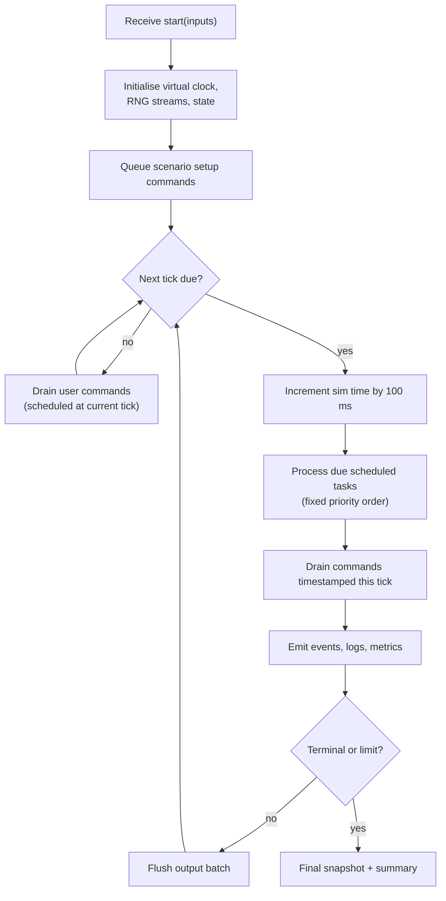

# Simulation Engine Design

> **Status:** Baseline · **Applies to:** `v0.1.0`  
> **Last updated:** 2026-11-24  
> **Related:** [Domain model](domain-model.md) · [Scenario schema](../reference/scenario-schema.md) · [Event catalogue](../reference/event-catalog.md)

## 1. Purpose

The engine turns immutable run inputs into a deterministic sequence of state changes,
logs, and metric samples. It models enough of a single-node deployment system to teach the
lifecycle, not enough to emulate a specific product. Where realism and reproducibility
conflict, reproducibility wins.

**Inputs:** source snapshot, scenario snapshot, seed, command trace, engine version.  
**Outputs:** domain events, structured logs, metric samples, final snapshot, result summary.

## 2. Non-negotiable rules

1. **No real effects.** No process spawn, socket, filesystem, network, DNS, clock, thread,
   or environment access inside `koncet-sim`.
2. **One mutable owner.** A single engine thread advances state; no shared mutable engine
   state or parallel subsystem simulation.
3. **Virtual time only.** All decisions use simulation time. Wall-clock timestamps are
   metadata added by the application layer for history display.
4. **Explicit randomness.** Randomness comes only from seeded ChaCha8 streams, partitioned
   by subsystem. Never from thread RNG, hash iteration order, OS entropy, or wall time.
5. **Deterministic ordering.** Use ordered maps/sets and stable tie-breakers. Collections
   that leak hash order are forbidden in state that affects output.
6. **Canonical output.** Event payloads, logs, and golden fixtures use canonical JSON with
   sorted keys and fixed numeric formatting.
7. **Recorded commands.** Every user action that affects state is an ordered, time-stamped
   command and is persisted.

## 3. Time model

| Concept | Definition |
| --- | --- |
| Tick | Fixed `100 ms` of simulated time. Never variable. |
| Simulation time | Monotonic integer milliseconds since run start. |
| Speed | How many ticks are processed per wall-second: 1×, 2×, 4×, 8×. Speed never changes tick size. |
| Pause | Commands and UI remain responsive; simulated time does not advance. |
| Frame | Engine output flush at most every `50 ms` wall time or every simulated second, whichever comes first. |
| Run limit | Scenario `max_sim_seconds` (default 3,600) prevents unbounded runs. |

The pacing loop sleeps outside the pure engine. Tests call `advance_to(t)` and run as fast
as possible. A long pause or scheduling delay never causes a “catch-up” that changes
outcomes: the engine processes elapsed ticks in order and coalesces UI delivery only.

## 4. Engine loop



### Fixed task order per tick

1. build stage progress / completions;
2. image promotion;
3. container state transitions;
4. app process lifecycle and supervisor decisions;
5. health checks;
6. proxy routing and connectivity probes;
7. firewall evaluation (when traffic is simulated);
8. metric sampling;
9. scenario duration and terminal conditions.

Fixed order avoids scheduling-dependent outcomes.

### Command timestamps

Commands are assigned the current simulated tick when accepted. For UI interaction during
pause, the command is applied at the paused tick without advancing time. The command trace
records command type, payload, and simulated time.

## 5. Determinism and reproducibility

### Seeded streams

One root seed (63-bit non-negative integer) is split into independent stream keys with a
domain-separated hash (for example `BLAKE3("koncet/rng/v1/build" || seed)`). Subsystems do
not consume from a shared stream, so adding a random draw to the process manager cannot
change build outcomes.

Suggested streams: `build`, `runtime`, `network`, `monitoring`, `faults`, `ui-jitter`
(display-only jitter must never affect state).

### Reproduction contract

For a fixed engine version, identical source snapshot, scenario snapshot, seed, and command
trace produce identical:

- ordered domain events and payloads;
- log records (time, source, level, message, context);
- metric samples;
- final state and result summary.

Wall-clock timestamps, UI rendering, and animation are not part of the contract.

Changing any observable engine behaviour requires updating golden runs and bumping the
engine compatibility version. Stored historical runs remain viewable; they are never
recomputed.

### Sources of accidental nondeterminism to ban

- iteration over `HashMap`/`HashSet` where order affects output;
- floating-point formatting differences (store canonical decimal strings or rounded ints);
- reading system time inside engine or domain;
- `std::thread` scheduling in simulation;
- selecting random values lazily during rendering;
- unordered asynchronous writes changing event sequence.

## 6. Simulated subsystems

The four named components are cohesive modules inside `koncet-sim`. They share the virtual
node's state but have explicit interfaces and event sources.

### 6.1 Container engine

**Responsibilities:** image availability, container creation, state transitions, resource
limits, exposed ports, volume-less runtime, removal. Images are immutable; containers are
mutable instances.

- A deployment creates at most one container in `v0.1`.
- Starting validates image, CPU/memory limits, environment keys, and port conflicts.
- “Ports” are virtual declarations; nothing binds on the host.
- Stop initiates graceful termination for a scenario-defined grace period, then force-stop.
- Removal is only legal after stop/failure.
- State is authoritative in the domain state machine; illegal transitions are rejected with
  a typed error, logged, and not emitted as state changes.

### 6.2 Process manager

**Responsibilities:** simulate the app process inside a running container, health checks,
exit codes, restart policy, backoff, restart exhaustion.

- Policies: `no`, `on-failure`, `always`; max retries default 3 for `on-failure`.
- Backoff is deterministic: `1 s, 2 s, 4 s`, capped; delays are simulated.
- Each restart increments the container restart counter and emits process/container events.
- Health check outcome is deterministic and depends on process state, startup delay,
  declared path/port, and injected faults. It does not perform I/O.
- Manual restart is a recorded user command and resets the supervisor's retry window but not
  the historical restart counter.
- The composed command is inert display text; it is never executed.

### 6.3 Reverse proxy

**Responsibilities:** one listener, one host/path route, route validation, virtual request
handling, and health-probe simulation.

- Hostnames MUST end in `.koncet.local`; the default is `app.koncet.local`.
- Match exact host (case-insensitive) and longest path prefix.
- Target must be a service alias plus an exposed container port.
- Duplicate host+path routes, missing targets, and unexposed ports are validation errors.
- A request is evaluated as: resolve route → apply firewall → check target process/health →
  return simulated result (`200`, `502`, `503`, `504`, or `denied`).
- Health probes emit low-volume request metrics; no arbitrary synthetic load exists in
  `v0.1`.
- Connectivity is end-to-end: a running container can still produce a `DEGRADED` deployment
  if the route is blocked or unhealthy.

### 6.4 Firewall

**Responsibilities:** deterministic packet-policy evaluation for simulated traffic.

- Default inbound policy: `deny` (safe default, explicit allow required).
- Rule fields: id, action (`allow`/`deny`), direction (`inbound` only in `v0.1`), protocol
  (`tcp`/`udp`), port or range, source alias (`proxy`, `monitor`, `external`).
- Evaluation: first matching rule wins in declaration order; otherwise default policy.
- Sources and destinations are virtual aliases, not IP addresses. No host network state is
  read or changed.
- A denied request produces a firewall denial event and a proxy error log, never a fake
  success.
- Contradictory or unreachable rules generate validation warnings, not silent fixes.

### 6.5 Build and image pipeline

Stages are fixed for `v0.1` and configurable only by duration scale and fault injection:

| Stage | Purpose | Default simulated duration |
| --- | --- | --- |
| Validate | Check snapshot, profile expectations, entrypoint, size limits | 2 s |
| Prepare | Represent dependency/setup work | 6 s |
| Build | Represent compilation/bundling | 12 s |
| Package | Produce the image manifest and layers | 3 s |

Durations are scaled by scenario `duration_scale` and rounded deterministically. Faults can
fail a stage at a configured percentage of its duration. Once a stage fails, later stages are
skipped and no image is produced.

**Image model:** repository, tag, canonical manifest, SHA-256 digest, size, and ordered
layers (`base:<profile>`, `app:<source-hash>`). Repository/tag are derived from immutable IDs
(`koncet/<project-id[0:8]>/app:run-<run-id[0:8]>`), not editable in `v0.1`. The digest is
computed from the canonical manifest (including profile, source hash, layer metadata, and
engine version) and is visibly marked as simulated. Size is derived deterministically from
profile baseline and snapshot byte size; it is not a measurement.

### 6.6 Deployment status

Deployment health is derived, never set arbitrarily:

```text
FAILED     if build failed, container failed, or restarts exhausted
PENDING    before an image exists
DEPLOYING  while container starts and initial health checks run
HEALTHY    if container is running + app process healthy + route reachable + firewall allows
DEGRADED   if container is running but app or end-to-end route is unhealthy
STOPPED    after a user/completion stop
```

The primary reason is a stable code (for example `firewall_denied`, `route_unreachable`,
`healthcheck_failed`, `restart_exhausted`) plus a human explanation. State transitions and
invariants are in [Domain model](domain-model.md).

## 7. Scenario execution model

A scenario is validated before run start and snapshotted. Its sections map to subsystems:

| Scenario section | Engine effect |
| --- | --- |
| `build` | profile, duration scale, stage failure injection |
| `service` | container config, resources, process behaviour, restart, health check |
| `proxy` | listener, host/path route |
| `firewall` | default policy and ordered rules |
| `faults` | deterministic process crash, startup stall, and health-check failure; connectivity denial is expressed through firewall rules |
| `monitoring` | sample interval and per-series sampling caps |
| `limits` | max simulated duration, stop-on-terminal-failure |

Faults are declarative and deterministic: “crash once at 20 s after process start”, not
random chaos. Every fault must produce an explanatory event and log. See
[Scenario schema](../reference/scenario-schema.md).

## 8. Logs

Each log record contains: simulated time, monotonic sequence, source
(`build|container|process|proxy|firewall|deployment|engine`), level
(`debug|info|warn|error`), message, and optional structured context (`stage`, `port`,
`rule_id`, `container_id`, `reason`).

Rules:

- Messages are concise, stable, and written for humans; identifiers live in context.
- No ANSI escape codes, host paths, secrets, or wall-clock timestamps in the message.
- High-frequency events are rate-limited deterministically (for example repeated probe
  failures) with an aggregate notice.
- The per-run log cap is 25,000 records. At the cap, logging stops and one truncation event
  is emitted; domain events are never dropped.
- Logs are product data, separate from application diagnostics (`tracing`).

## 9. Basic monitoring model

Metrics are simulated, clearly labelled, and generated on a fixed schedule. They are not
measurements of the host. Sampling interval defaults to 5 simulation seconds
(range 1–60 s).

| Metric | Unit | Model summary |
| --- | --- | --- |
| `container.cpu.percent` | % of limit | idle floor + deterministic load profile + bounded jitter; drops on stop |
| `container.memory.used_bytes` | bytes | warm-up curve, steady band, reset on restart, capped by limit |
| `container.network.rx_bytes_per_s` | B/s | probe-driven traffic + small baseline |
| `container.network.tx_bytes_per_s` | B/s | response volume + small baseline |
| `container.restarts` | count | derived from process supervisor |
| `deployment.healthy` | 0/1 | derived status sample for charts |
| `proxy.requests_per_s` | req/s | health/connectivity probes only in `v0.1` |
| `proxy.error_rate` | % | failed probes over a rolling window |

UI charts show at most 1,000 points by deterministic downsampling. Values are illustrative
and must never be presented as host telemetry.

## 10. Event delivery and backpressure

- Domain events carry a per-run monotonic `seq`, `sim_time_ms`, category, type, severity,
  source, and versioned JSON payload.
- The application layer persists domain events before publishing them to the UI.
- Logs and metrics are batched (for example 100–250 ms) and may lag under load; domain state
  never does.
- Bounded channels protect memory. If the display falls behind, log/metric batches may be
  coalesced; domain events are never silently discarded. Persistent backpressure beyond the
  bound is a fatal session error with a recovery message.
- UI updates are snapshots plus incremental timeline events at up to ~20 Hz, not one rebuild
  per engine tick.

## 11. Termination

A run ends when:

- the user stops it → outcome `cancelled` or `stopped` depending on final state;
- a terminal failure occurs and `stop_on_terminal_failure` is true → result `build_failed`
  or `runtime_failed`;
- the maximum simulated duration is reached → final result reflects current health;
- the app shuts down gracefully → engine stops, flushes, and finalises;
- the app crashes → startup reconciliation marks the run `cancelled` with reason
  `app_terminated`.

Finalisation is idempotent and writes a summary containing final build/image/container/
deployment statuses, duration, counts, and result.

## 12. Headless test harness

`koncet-sim` exposes a pure `Simulation` API that tests drive without wall-clock waits:

```text
Simulation::new(inputs) -> Simulation
Simulation::command(cmd)
Simulation::advance_to(sim_time)
Simulation::drain_output() -> events/logs/metrics
Simulation::snapshot() -> RunView
```

Golden tests serialise outputs to canonical JSON and compare against fixtures. The command
trace used by a fixture is part of the fixture. Performance tests advance one simulated hour
without rendering and assert the budget in the PRD.
