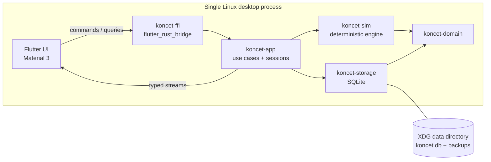

# Technology Stack and Selection Rationale

> **Status:** Baseline · **Applies to:** `v0.1.0`  
> **Last updated:** 2026-11-24  
> **Related:** [Architecture overview](overview.md) · [ADRs](adr/README.md)

KONCET deliberately uses a small stack. The goal is a performant, native-feeling Linux
desktop product that is easy to reproduce and release from one repository. Exact versions
are pinned when the implementation starts; this document defines the selection and the
constraints around upgrading.

## 1. Selected stack

| Concern | Choice | Why | Primary alternative rejected |
| --- | --- | --- | --- |
| Desktop UI | **Flutter + Dart, Material 3** | Productive custom UI, mature Linux desktop support, first-class Material 3, strong animation and testing tools | Qt/C++ (slower iteration), GTK4 (weaker cross-platform path), Tauri/web UI (webview inconsistency), egui (less mature form/accessibility ecosystem) |
| Core engine | **Rust (stable)** | Predictable performance, strong type system, memory safety, excellent deterministic, I/O-free libraries, good FFI | Pure Dart (less headroom for engine simulation and native packaging), C++ (higher maintenance risk), Go (runtime and FFI packaging overhead) |
| UI ↔ core | **`flutter_rust_bridge` v2, in-process** | No network, no sidecar process, typed codegen, async commands and streams, single distributable app | Local HTTP/WebSocket sidecar (adds ports/security/lifecycle), gRPC (heavy), hand-written C ABI (unsafe and costly) |
| State management | **Riverpod** | Testable dependency injection, async/stream providers, good fit for generated immutable bridge data | Provider (less safety), BLoC (more ceremony), global singletons (untestable) |
| Navigation | **`go_router`** | Declarative desktop routes, deep-linkable run/project URLs within the app, testable | Navigator 1.0 (harder to structure) |
| Local database | **SQLite via `rusqlite` (bundled)** | Relational querying, transactions, migrations, single-file ownership, no server, deterministic tests | JSON files (weak consistency/querying), embedded KV (no relational history), Postgres (external service prohibited), Dart `drift` (splits persistence away from engine) |
| Migrations | Embedded SQL migrations with a small runner | Reviewable schema history; runs at startup; backup before change | ORM auto-migration (less explicit) |
| Serialisation | **Serde / `serde_json`** | Mature, explicit versioned structs, canonicalisation support | Protobuf (overkill for local data), YAML (ambiguity/security complexity) |
| Deterministic RNG | **`rand_chacha` (ChaCha8)** | Reproducible, fast, seedable, portable | Thread RNG (non-deterministic), custom LCG (poor statistical quality) |
| IDs | **UUIDv7** | Time-ordered keys improve SQLite locality; globally unique without coordination | Auto-increment integers (weaker merge/import story) |
| Time | Injected clock + virtual tick loop | Determinism and fast tests | Wall clock in engine (untestable, non-reproducible) |
| Logging (diagnostics) | **`tracing` + rolling file appender** | Structured native diagnostics, filtering, low overhead | `println!` (unmanageable), remote telemetry (prohibited) |
| Charts | **`fl_chart`** | Native Flutter charts, sufficient for basic monitoring, MIT licence | Syncfusion (commercial/community licence complexity), WebView charting (heavy/inconsistent) |
| Code editor | Native Flutter editor (MIT/Apache/BSD) selected in M1 spike | Must support Linux keyboard/IME, syntax highlighting, undo/redo, large files | Monaco in WebView (heavy, inconsistent, security surface), plain text field (poor UX) |
| Window integration | **`window_manager`** (MIT) or minimal GTK integration | Minimum size, title, close interception, persisted geometry | No desktop integration (poor UX) |
| Fonts | **Inter** (UI) + **JetBrains Mono** (code/logs), bundled | Legible, tabular figures, OFL licences, offline | System-only fonts (inconsistent metrics), custom proprietary fonts |
| Icons | **Material Symbols Rounded**, bundled | Consistent with Material 3, Apache-2.0 | Mixed icon packs (visual inconsistency) |
| Task runner | **`just`** | Simple documented recipes across Rust, Flutter, docs, packaging | Shell-only instructions (error-prone), Make (less portable syntax) |
| Packaging | **AppImage + tar.gz** | Distro-agnostic GitHub distribution, no store account, no daemon | Flatpak/Snap (store infrastructure), distro repos (maintenance burden), `.deb` only (coverage) |
| Licence | **GPL-3.0-or-later** | Copyleft protection for a long-lived portfolio product; FSF-recommended “or later” | MIT/Apache (no copyleft), AGPL (network clause not relevant) |

Architecture-level decisions and consequences are recorded in the
[ADR index](adr/README.md). This table is a summary; ADRs win on conflict.

## 2. What is *not* in the stack

KONCET does not embed or control:

- Docker, Podman, containerd, runc, Kubernetes, or any container runtime;
- Nginx, Caddy, Traefik, Envoy, or any real reverse proxy;
- systemd, supervisord, or a host process manager;
- `nftables`, `iptables`, `ufw`, or any host firewall;
- Git/GitHub APIs, registries, cloud SDKs, CI systems, or databases as a service.

Their concepts are modelled inside the Rust simulation engine. This is a product boundary,
not a temporary implementation gap. See
[ADR-0006](adr/0006-offline-simulation-boundary.md).

## 3. Runtime architecture summary

No sockets, daemons, queues, or external services participate at runtime.

## 4. Platform baseline

| Item | `v0.1.0` baseline |
| --- | --- |
| OS | Linux x86_64 |
| glibc | 2.35+ (build on Ubuntu 22.04 runner) |
| Display | X11 or Wayland through Flutter/GTK; window minimum 1024×720 |
| CPU / RAM | 4-core reference, 8 GB; application budget under 700 MB |
| Disk | 500 MB free plus user data |
| Distribution | AppImage primary; `.tar.gz` fallback |
| Tested distributions | Ubuntu 22.04/24.04, Fedora latest stable, Arch current |

The build runner defines the compatibility floor. Newer runners must not silently raise the
glibc requirement without a PRD/ADR update and release-note warning.

## 5. Version and upgrade policy

- Flutter and Rust are pinned in repository toolchain files when scaffolding begins.
- Lockfiles (`Cargo.lock`, the workspace `pubspec.lock`) are committed.
- Upgrades happen in dedicated pull requests with full test, golden-run, packaging, and
  licence checks.
- Pre-1.0 versions may change persisted formats only with a migration and backup.
- Engine behaviour changes that affect determinism require an intentional golden-run
  update and a note in the run metadata compatibility policy.
- Dependency licences must be compatible with GPL-3.0-or-later. A denied licence blocks
  merge.

## 6. Reference hardware and budgets

Performance is measured on a reference machine with 4 logical cores, 8 GB RAM, SSD, and
1080p display, using release builds. Budgets are defined in the
[PRD non-functional requirements](../product/prd.md#9-non-functional-requirements) and
enforced by [testing strategy](../engineering/testing-strategy.md).
