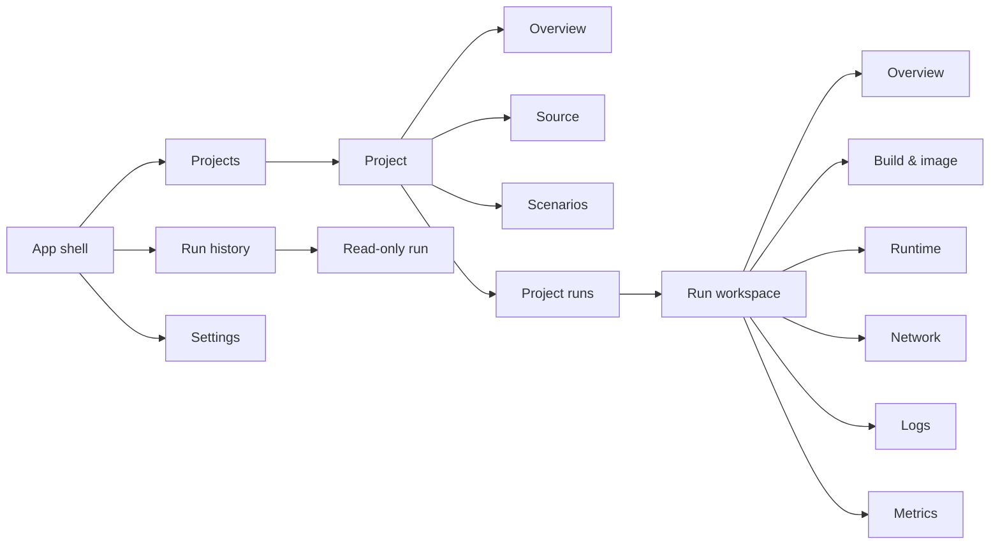

# Screens and User Flows

> **Status:** Baseline · **Applies to:** `v0.1.0`  
> **Last updated:** 2026-11-24  
> **Related:** [Design system](design-system.md) · [Use cases](../product/use-cases.md) · [PRD](../product/prd.md)

## 1. Information architecture



Global navigation rail: **Projects**, **Run history**, **Settings**. The project-scoped tabs
are **Overview**, **Source**, **Scenarios**, **Runs**. The run workspace has its own persistent
header and six tabs. The active-run indicator appears in the rail and top bar from anywhere.

## 2. App shell

```text
┌───────────────────────────────────────────────────────────────────────────────┐
│ KONCET  │ Project / Run title                     ● SIMULATED   ◐ 12:34  ⋯    │ 56
├──────────┬────────────────────────────────────────────────────────────────────┤
│ Projects │  Page header: title · description · primary action                │
│ History  │                                                                    │
│ Settings │  Content                                                           │
│          │                                                                    │
│ ● active │                                                                    │
└──────────┴────────────────────────────────────────────────────────────────────┘
```

- Top bar: breadcrumb/title, simulated marker, active sim clock when relevant, command overflow.
- Rail expands at ≥1280 px, collapses to icons at 1024–1279 px.
- Content padding 24/32 px. A 320 px inspector may appear inside editor/run surfaces.
- Global active-run chip opens the current run. Starting a second run is blocked with an
  explanatory dialog.

## 3. Projects — landing

**Purpose:** resume work or create something new.  
**Route:** `/projects`

Layout:

1. Page header: “Projects”, short description, primary **New project**.
2. Search + filter chips: All / Active / Archived.
3. Project grid (cards) or list at narrow widths. Card shows name, description, template,
   last edited, latest result badge, active-run badge.
4. Empty state: explanation of the simulation, **Create your first project**, link to docs.
5. Archived projects render muted with an unarchive action.

No hero illustrations. Maximum four recent runs may appear below the project grid when at
least one run exists.

**States:** loading skeleton cards; empty; load error with retry/diagnostics; search no-results.

## 4. New project

A single dialog (or compact wizard at narrow widths):

1. Name and optional description.
2. Template cards: Blank, Static Web, HTTP Service, each with a one-line outcome and file count.
3. **Create project** primary action.

Template application creates source files and a baseline `Happy Path` scenario. The UI
explains that templates are inert examples, not working applications.

Validation: required name, 1–80 chars; duplicate names allowed with warning; creation failure
keeps the dialog open and shows the error.

## 5. Project shell

**Route:** `/projects/:id`

- Header: project name, template badge, last edit, **Run** primary action (opens scenario
  chooser if more than one), overflow (rename, duplicate, archive, delete).
- Tabs: **Overview · Source · Scenarios · Runs**.
- Overview: short description, latest run result/reason, quick counts (files, scenarios, runs),
  active-run card, recent runs table. A “Getting started” checklist disappears after the first
  successful run.
- Delete: confirmation states that all source, scenarios, runs, logs, and metrics will be
  removed permanently and cannot be recovered without a backup.

If an active run belongs to another project, the Run action explains that a run is already in
progress and offers to open it.

**Project Runs tab:** a project-filtered version of the run history table with columns for
run, scenario, result, duration, seed, and started time. It supports result filtering and opens
read-only run detail. Empty state offers the baseline scenario; it does not create a run
implicitly.

## 6. Source

**Route:** `/projects/:id/source`

```text
┌ Files ─────────┬ Editor ──────────────────────────────────────────────┐
│ + New file     │ src/index.html                            [Saved]    │
│ ▾ src          │  1  <!doctype html>                               │
│   index.html   │  2  <html>                                        │
│   styles.css   │  3  ...                                           │
│ README.md      │                                                    │
│                │ js · 42 lines · 1.2 KiB      Saved locally · inert │
└────────────────┴─────────────────────────────────────────────────────┘
```

- File tree: create file (the path may introduce folders), rename, delete, and select. Folders
  are derived from file paths, not stored as objects; the tree is sorted by path.
- Editor: line-number gutter synced to the editor scroll, monospace text, native undo/redo,
  and autosave after 700 ms. Status shows `Saving…`/`Saved`/`Save failed`.
- **Validate** runs the Rust source-integrity check and shows path-linked findings in a dialog.
- Empty tree: the editor shows an empty state and file creation remains available.
- Deleting a file uses a destructive confirmation. There is no entrypoint-specific guard in
  v0.1; run-start validation remains authoritative.
- No upload/import, syntax highlighting package, or find/replace in `v0.1`; the footer states
  that source is saved locally and never executed.

Failure states: project read error with retry; save errors stay visible in the editor status
bar and retry on the next edit or **Save now**.

## 7. Scenarios

Scenarios are listed inside the project overview rather than on a separate route in `v0.1`.

- Each row shows name, description, revision, selection radio, **Run**, edit, duplicate, and
  delete actions.
- Primary action **New scenario** opens a preset gallery: Happy Path, Build Failure, Blocked
  Port, and Crash Loop. New scenarios inherit the project template's build profile.
- Deleting a scenario referenced by history is rejected by storage. History snapshots keep
  prior runs readable.
- Empty state explains scenarios and offers the Happy Path preset.

### Scenario editor

**Route:** `/projects/:id/scenarios/:scenarioId`

Single scrollable form with grouped sections and a persistent header. Validation findings
appear at the top; the canonical JSON is available as a read-only preview.

| Section | Fields |
| --- | --- |
| Identity | Name, description |
| Seed policy | Random or fixed, with the decimal seed value |
| Build | Profile, duration scale, stage failure injections (stage, position %, message) |
| Service | Name, inert command, CPU, memory, port, startup delay, env vars, restart policy/retries, health check |
| Proxy | Enable switch, listener port, host, path, target port |
| Firewall | Default policy and ordered allow/deny rules (id, action, protocol, port, source) |
| Fault injection | Process crash, startup stall, health-check failure with their allowed fields |
| Limits and monitoring | Maximum simulated seconds, stop-on-terminal-failure, sample interval |

- Changes mark the draft dirty and autosave after 900 ms once the Rust validator accepts them.
  A blocking validation failure keeps the draft dirty and shows the issue list.
- **Save now** is available; there is no separate **Save & run** in `v0.1`.
- Starting a run from the project overview is blocked while another run is active; the callout
  offers to open the active run.
- The canonical JSON preview is read-only; raw config editing is not supported in `v0.1`.

## 8. Run workspace

**Route:** `/runs/:runId` (active) or `/history/:runId` (read-only). The same components are
reused; historical mode hides mutation controls.

```text
┌ Happy Path · seed 42        ● RUNNING   ✓ UNKNOWN   ◐ 00:01:12  1×  ⏸  ■   SIMULATED ┐
├───────────────────────────────────────────────────────────────────────────────────────┤
│ Build pipeline (always visible)        │  Deployment summary                        │
│ ✓ Validate  ✓ Prepare  ● Build  ○ …    │  image tag, route, uptime, restarts        │
├───────────────────────────────────────────────────────────────────────────────────────┤
│ Timeline        Logs        Metrics        Inspect                                    │
└───────────────────────────────────────────────────────────────────────────────────────┘
```

### 8.1 Persistent session header

- Run identifier/title, scenario, project.
- Live status badge: running, paused, completed, cancelled, failed.
- Simulated clock `HH:MM:SS`, speed menu 1×/2×/4×/8×, pause/resume, stop.
- **SIMULATED** tag and a tooltip explaining no real infrastructure is affected.
- Historical mode replaces controls with the final result and timestamps.

### 8.2 Persistent summary

The run header and the build/deployment summary stay visible across tabs:

1. Status, result, simulation clock, speed, seed, app/engine versions.
2. Primary reason callout when the run is degraded, failed, or cancelled.
3. Four-stage pipeline with planned/actual durations and failure text.
4. Deployment summary with image reference, simulated hostname, uptime, container state, and
   restart count. `Inspect` expands the full image, container, process, command trace, and run
   identity.

Build failure shows no fake endpoint: the reason callout names the failing stage and the
pipeline marks later stages skipped.

### 8.3 Timeline

- Newest-first ordered events with severity icon, simulation time, event type, source, and
  sequence number.
- Search over type/payload; debug events hidden by default.
- Expanding an event shows its canonical JSON payload. Unknown event types render generically.

### 8.4 Logs

- Monospace, virtualised list with simulation timestamp, source, and message.
- Filter by level and source; bounded search; follow mode (default on) and line counts.
- Live logs are display-only, never reorder, and are deduplicated by sequence. The in-memory
  view keeps the most recent 5,000 lines; the database retains up to the engine cap.

### 8.5 Metrics

- Latest container/deployment values as compact tiles.
- One line chart per metric series with time on the x-axis, units on the y-axis, and a textual
  summary above each chart. Charts use role colours and are labelled; no information depends
  on hue alone.
- Empty state before the first monitoring sample.

### 8.6 Inspect

- Simulated image reference, digest, profile, size, source hash, and ordered layers.
- Container/process state, image ID, service port, CPU/memory limits, restart policy, health
  path, PID/attempt, exit code.
- Recorded command trace in sequence order (historical/finalised runs).
- Run identity: run/project/scenario/snapshot IDs, seed, timestamps, schema and event sequence.
- Read-only scenario snapshot JSON.

### 8.7 Network observations

The proxy route and firewall consequences are observed through timeline events
(`proxy.*`, `firewall.*`), the deployment reason callout, and **Check connectivity** in the
run actions menu. `v0.1` does not have a separate Network tab or route diagram; adding one is a
follow-up and must preserve the same simulation semantics. All hostnames/ports are marked
simulated; there is no “Open in browser” action in `v0.1`.

### 8.8 Run completion

On terminal state, header switches to result (`HEALTHY`, `DEGRADED`, `BUILD FAILED`, …), controls
disable, and a summary sheet appears inline:

- duration, seed, scenario, source snapshot;
- final build/image/container/deployment;
- primary reason or success statement;
- actions: **Run again**, **Back to project**, **View history**.

No modal celebration; the product is an instrument. Success is clear and quiet.

## 9. Run history

**Route:** `/runs`

- Page header with aggregate tiles and **Refresh** / **Clear history** actions.
- Filters: project, run status, and a bounded search over scenario, project, and run id.
- Table columns: status, result, scenario/project, started time, duration, row actions.
- Row opens `/runs/:runId`; the overflow menu offers open and delete with consequence copy.
- Clear history respects the selected project filter and is refused while an active run would
  be deleted.
- Empty state before any run; a no-results state keeps the filters and explains how to reset.
- Historical detail is strictly read-only; **Run again** reuses the same project, scenario, and
  seed to reproduce the run. The run menu can delete one run or clear history.

## 10. Settings

**Route:** `/settings`

Sections:

1. **Appearance** — System/Light/Dark; optional reduced motion; the theme is a fixed Material 3
   scheme with no dynamic wallpaper colour.
2. **Simulation defaults** — default speed for new runs. Quit confirmation with an active run
   is handled by the window close interceptor.
3. **Local storage** — XDG data directory (copyable), database/WAL/backup usage, project/run/
   event/log/metric counts, Create backup, backup list with delete, and an integrity check.
4. **About** — app/engine/schema versions, build commit, platform, GPL-3.0-or-later licence,
   third-party notices, no telemetry statement, Copy diagnostics, and the Flutter licence page.

No account, network, or update-check sections exist.

## 11. Cross-cutting states

| State | Behaviour |
| --- | --- |
| No project | Projects empty state with one primary action |
| No active run | Run controls disabled with explanation; no fake clock |
| Backend initialising | Window visible with skeleton shell; no interactive forms until ready |
| DB recovery | Blocking recovery screen with path, diagnostics, backup/restore instructions, quit |
| Active run elsewhere | Dialog identifies project/run and offers open or cancel |
| Save failure | Inline persistent error, retry, never silent |
| Unknown event type | Neutral timeline row with type and payload summary |
| Missing historical scenario/project | Historical run still opens; links disabled with explanation |

## 12. UX acceptance checklist

- [ ] Core journey works entirely by keyboard.
- [ ] Every screen has empty, loading, error, and retry where applicable.
- [ ] No screen implies real infrastructure or external access.
- [ ] Status has icon + label and a primary reason when not healthy.
- [ ] Active run remains visible and reachable from any route.
- [ ] Destructive actions describe exactly what data is removed.
- [ ] Live logs do not steal focus or scroll when follow is off.
- [ ] Light/dark and 1024×720/1440×900 layouts reviewed.
- [ ] Simulation clock and all metric values use tabular mono figures.
