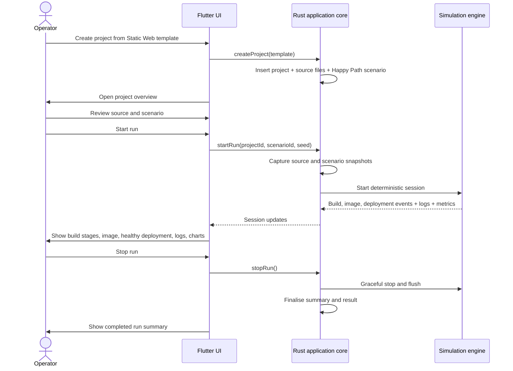

# Use Cases and User Journeys

> **Status:** Baseline · **Applies to:** `v0.1.0`  
> **Last updated:** 2026-11-24  
> **Related:** [PRD](prd.md) · [Screens and flows](../design/screens-and-flows.md) · [Event catalogue](../reference/event-catalog.md)

This document describes the behaviours KONCET must support from the user's point of
view. Each use case has observable acceptance criteria. UI layout is specified in
[Screens and flows](../design/screens-and-flows.md); internal rules are in the
[Simulation engine](../architecture/simulation-engine.md).

## Actor

**Operator** — a single local user. There are no roles, accounts, or privileged users.

## UC-01 — First project and baseline deployment

**Goal:** Go from an empty application to a healthy simulated deployment.  
**Preconditions:** KONCET is installed and the database is empty or contains no active run.  
**Scenario:** `Happy Path`, template `Static Web`.

### Main flow

### Acceptance criteria

1. Creating the project takes no more than one dialog/wizard and produces valid source,
   one baseline scenario, and no run.
2. The source view shows the template files; the scenario view shows the Happy Path preset.
3. Starting a run captures an immutable snapshot; editing source afterwards is possible
   but does not change the active run.
4. Stages progress Validate → Prepare → Build → Package and log their transitions.
5. On build success, exactly one image and one deployment are created.
6. The container reaches `RUNNING`; the process manager reports a live process; the proxy
   route and firewall rule permit the simulated health check.
7. The deployment becomes `HEALTHY` and the UI shows its endpoint
   `http://app.koncet.local`.
8. CPU, memory, network, and health metrics appear in the Metrics tab.
9. Stopping the run moves the container through a graceful stop and finalises the run.
10. The completed run appears in history and reopens after an app restart with the same
    result, image digest, logs, and final statuses.

**Postcondition:** One completed run is stored; project source remains editable.

## UC-02 — Diagnose and fix a failed build

**Goal:** Understand a build failure and make the next run succeed.  
**Precondition:** No active run.

1. The operator duplicates the `Build Failure` preset or edits a scenario to inject a
   failure in the `Build` stage with message `Compiler exploded`.
2. Starting the run shows stage `Build` become `failed`; later stages remain `skipped`.
3. The image and deployment are absent; the run result is `build_failed`.
4. The Logs tab is filtered to the failing stage, with the injected message and the source
   file context.
5. The operator disables the fault injection, returns to the scenario, and starts a new run.
6. The new run builds, deploys, and reaches `HEALTHY`.

**Acceptance criteria**

- The failure event points to the scenario field that caused it.
- No partial image is visible as deployable.
- The failed run remains in history with its original configuration.
- The second run uses a new source/scenario snapshot and is independently reproducible.

## UC-03 — Repair blocked connectivity

**Goal:** Learn how a firewall rule changes end-to-end health.  
**Precondition:** A baseline scenario exists and no run is active.

1. The operator duplicates the baseline scenario, opens its Networking section, and removes
   the inbound allow rule from source `proxy` to the service port.
2. Starting the run results in:
   - container health checks passing (the app itself is running);
   - proxy connectivity checks failing with `connection_denied`;
   - a firewall event and proxy error log;
   - deployment status `DEGRADED` with reason `firewall_denied`.
3. On the Network tab, the route is visually marked unreachable and the missing rule is
   linked to the scenario editor. A connectivity check confirms the failure.
4. The operator restores the allow rule in the scenario and starts a **new run**, which
   reaches `HEALTHY`. The first run remains `DEGRADED` in history.
5. Scenario edits never mutate an active or historical run.

**Acceptance criteria**

- Firewall evaluation is deterministic and shown in logs.
- A blocked route never produces fake success.
- The UI distinguishes container health from deployment health.
- Hostnames and ports are visibly marked as simulated.

## UC-04 — Observe a crash loop

**Goal:** Understand restart policy and exhaustion.  
**Precondition:** The `Crash Loop` scenario is configured and no run is active.

1. The operator starts the `Crash Loop` preset with `on-failure` restart policy,
   maximum three restarts, and a crash fault.
2. The process exits; the supervisor schedules a restart with deterministic backoff.
3. Each restart increments the restart count and emits process/container events and logs.
4. After the third retry, the supervisor stops; the container becomes `FAILED`; the
   deployment becomes `FAILED` with reason `restart_exhausted`.
5. The Metrics tab shows restart count and health status over time.

**Acceptance criteria**

- Restart intervals are deterministic and visible.
- Logs identify the exit reason and retry count.
- A manual restart after exhaustion is possible and recorded as a user command.
- A separate scenario with restart policy `always` continues retrying until stopped, while
  still surfacing repeated failure. The active run's policy is never changed mid-run.

## UC-05 — Review historical run

**Goal:** Inspect a previous run without re-running the simulation.  
**Precondition:** At least one completed run exists.

1. The operator opens Run History, filters by project and result, and opens a run.
2. The detail view shows summary, final build/image, deployment/container snapshot,
   timeline, logs, and charts.
3. All controls that mutate a run are absent or disabled; the view is read-only.
4. The operator copies the seed and scenario values to understand reproducibility.
5. The operator may delete the run after confirmation; related events, logs, and metrics
   are removed with it.

**Acceptance criteria**

- History opens without starting the engine.
- Values match the information observed live.
- Empty/loading/error states are present.
- Unknown event types from older versions render as a generic timeline item rather than
  crashing.

## UC-06 — Manage local data safely

**Goal:** Keep ownership and control of local data.

1. Settings shows database path, disk usage, schema version, and last backup.
2. The operator triggers Backup; a timestamped copy is written under the app data
   `backups/` directory and verified.
3. Before any schema migration, the app creates and verifies a backup automatically.
4. If the app is opened twice, the second instance is refused or focuses the existing one;
   it never opens a concurrent writer.
5. Quitting with an active run requires an explicit choice; on abnormal termination the
   next start marks the run `cancelled` with `app_terminated`.

**Acceptance criteria**

- No file outside the documented application directories is created or modified.
- Backup and restore/rollback instructions are available in the UI or documentation.
- No network access occurs during any use case.

## Coverage map

| Journey | Requirements |
| --- | --- |
| UC-01 | FR-PROJ, FR-SRC, FR-SCN, FR-RUN, FR-BLD, FR-CNT, FR-DEP, FR-OBS |
| UC-02 | FR-BLD-01..06, FR-OBS-01..03, FR-RUN-03..04 |
| UC-03 | FR-NET-01..06, FR-DEP-02 |
| UC-04 | FR-CNT-02..05, FR-OBS-04..05 |
| UC-05 | FR-HIS-01..02, FR-OBS-06 |
| UC-06 | FR-SYS-02..07, FR-RUN-06 |
