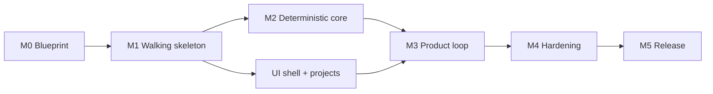

# Phase 1 Implementation Plan — `v0.1.0`

> **Status:** Baseline · **Last updated:** 2026-11-24  
> **Related:** [PRD](../product/prd.md) · [Roadmap](../product/roadmap.md) · [Testing](../engineering/testing-strategy.md) · [Release](../engineering/release-and-distribution.md)

## 1. Objective

Deliver a mature, offline Linux desktop product that completes one deployment simulation loop
with high quality:

**Project → virtual source → scenario → deterministic run → build/image → container/deployment
→ logs/metrics → history → repeat.**

The plan is milestone-based, not date-based. A milestone is complete only when its exit criteria
and documentation are satisfied. No milestone is skipped to make a demo look complete.

## 2. Workstreams

| ID | Workstream | Outcomes |
| --- | --- | --- |
| WS-DOC | Documentation and decisions | Baseline docs, ADRs, schema contracts, resolved contradictions |
| WS-FND | Foundation | Monorepo workspaces, toolchain pins, CI-ready recipes, app/Rust skeleton |
| WS-DOM | Domain and storage | Pure types, state machines, SQLite schema, migrations, repositories |
| WS-SIM | Simulation | Virtual clock, engine loop, build/image, container/process, proxy/firewall, metrics |
| WS-APP | Application/FFI | Use cases, active session, event persistence/fan-out, bridge API and streams |
| WS-UI | Design system and screens | Material 3 tokens/components, project/source/scenario/run/history/settings UI |
| WS-QA | Verification | Unit/golden/property/migration/integration/accessibility/offline tests |
| WS-REL | Release | Packaging, checksums, notices, SBOM, release notes, Linux matrix |

## 3. Milestones

### M0 — Blueprint (current)

**Deliverables**

- Product requirements, use cases, roadmap.
- Architecture, simulation, domain, data, bridge, security docs; eight ADRs.
- Design system and screen flows.
- Monorepo, workflow, testing, release plans.
- Scenario schema, event catalogue, glossary.
- GPL licence and repository governance files.

**Exit criteria**

- [x] Documentation tree complete and internally linked.
- [x] Stack decisions and alternatives documented.
- [x] Non-goals and simulation boundary explicit.
- [x] Determinism, storage, FFI, and UI contracts defined.
- [ ] Maintainer review sign-off (implementation may begin; unresolved items tracked in PRD §14).

### M1 — Walking skeleton

**Goal:** Prove the whole delivery path with the smallest end-to-end feature.

**Deliverables**

- Cargo workspace + Dart pub workspace + pinned toolchains + `just` recipes.
- Flutter Linux app launches, initialises Rust core, shows app/engine/schema versions.
- SQLite opens, initial migration runs, `projects` table exists.
- Project list/create/rename/delete through the FFI and a minimal real UI.
- Empty/lock/recovery handling for database initialisation.
- Generated bridge committed; drift check; basic architecture/dependency tests.
- Code-editor spike decides the package and records an ADR addendum if needed.

**Exit criteria**

- `just bootstrap`, `just run`, `just check` work from a clean documented environment.
- A project survives app restart.
- A second instance does not open a second DB writer.
- FFI panic test returns a typed error; no unwinding into Dart.
- Startup time measured; no blocking call on the UI isolate.

### M2 — Deterministic core

**Goal:** Complete the engine and persistence before polishing screens.

**Deliverables**

- Domain entities/state machines, validators, canonical serialisation.
- Scenario schema v1, four presets, source snapshots.
- Virtual clock, seeded RNG streams, fixed task order, command trace.
- Build stages, failure injection, image model/digest, container lifecycle, process supervisor.
- Proxy/firewall models and deployment-status derivation.
- Metrics and log generation with caps; event persistence and finalisation.
- Headless harness and golden runs for every preset.
- SQLite repositories for all v1 tables, migrations, cascade deletion, backup.
- No-I/O/network/process architecture tests.

**Exit criteria**

- All golden runs pass twice with identical canonical output.
- Property tests uphold state-machine invariants.
- Migration/cascade/backup tests pass.
- Build failure produces no image/deployment; blocked firewall yields DEGRADED, not HEALTHY.
- One simulated hour completes headlessly under budget.

### M3 — Product loop

**Goal:** Make the core usable through the complete UI.

**Deliverables**

- Design-system tokens and shared components; light/dark; density.
- App shell, Projects, New Project, Project shell, Source editor, Scenario editor/presets.
- Run workspace: Overview, Build & image, Runtime, Network, Logs, Metrics.
- Run controls (pause/resume/speed/stop), active-run indicator, session streams.
- History list/detail read-only; rerun flow.
- Settings: appearance, data usage, backup, diagnostics, about/licence.
- Validation, empty/loading/error/retry, destructive confirmations, keyboard navigation.
- Bridge integration tests and fake-stream controller tests.

**Exit criteria**

- UC-01 through UC-05 pass manually and in automated end-to-end coverage.
- All M requirements in PRD §8 are implemented.
- No screen implies real infrastructure; simulated labels are present.
- Light/dark goldens at 1024×720 and 1440×900 reviewed.
- Active run survives navigation and quit prompts behave as specified.

### M4 — Hardening

**Goal:** Meet non-functional, safety, and release-quality bars.

**Deliverables**

- Accessibility pass: focus, semantics, contrast, text scaling, reduced motion.
- Performance tuning against budgets; log virtualisation and metric downsampling.
- Crash/abnormal termination reconciliation; DB corruption/recovery screen.
- Security/offline test suite; path/size corpus; dependency licence report.
- Full migration fixtures; backup/restore drill.
- Linux distribution QA on Ubuntu 22.04/24.04, Fedora, Arch; X11/Wayland and scaling.
- Documentation sync, screenshots, known limitations.

**Exit criteria**

- PRD §9 budgets met on reference hardware.
- Offline syscall check passes.
- No denied dependencies; SBOM/notices generated.
- No P0/P1 defects; P2s documented with workarounds.
- Recovery and second-instance paths verified.

### M5 — Release `v0.1.0`

**Goal:** Publish a verified GitHub-only release.

**Deliverables**

- Version sync, changelog, release notes, known issues, upgrade/rollback notes.
- AppImage, tar.gz, `SHA256SUMS`, SBOM, third-party notices.
- Tag `v0.1.0` built from a clean commit; artifacts verified on a clean machine.
- GitHub Release published with GPL source link and verification instructions.
- Retrospective recorded; follow-up issues triaged.

**Exit criteria**

- All release gates in [Release and distribution §4](../engineering/release-and-distribution.md#4-release-gates)
  pass.
- Download → launch → complete a run → restart and reopen history, on at least two distributions.
- Checksums and notices match the published assets.
- Documentation links match the shipped version.

## 4. Recommended build order

1. **M1 skeleton first.** Do not build the full engine in isolation from the delivery path.
2. Domain types and schema next; write validation and invariants before UI forms.
3. Headless simulation + golden tests before wiring elaborate screens.
4. Persistence and active-session orchestration before live UI polish.
5. Design system before feature screens, but only components needed by the current milestone.
6. Run workspace after project/source/scenario flows; use real core data, no mock-only screens.
7. Hardening is a phase, not a final bug sweep.

## 5. Dependency map

The UI shell can progress in parallel with M2 only against stable DTO contracts. Any proposed
contract change goes through the bridge/data-model documents first.

## 6. Quality gates per milestone

| Gate | M1 | M2 | M3 | M4 | M5 |
| --- | --- | --- | --- | --- | --- |
| Format + lint | ✓ | ✓ | ✓ | ✓ | ✓ |
| Unit tests | basic | comprehensive | comprehensive | full | full |
| Golden runs | — | presets | presets | presets + regressions | full |
| Migration tests | initial | all v1 paths | full | full | full |
| Widget/golden | shell | — | critical screens | full matrix | reviewed |
| E2E | launch/project | headless journeys | main journey | all journeys | clean machine |
| Offline/security | — | architecture checks | smoke | full | release proof |
| Performance | startup baseline | engine budget | UI budgets | full budgets | regression check |
| Docs | updated | updated | updated | sync | release notes/screenshots |

## 7. Execution risks

| Risk | Trigger | Response |
| --- | --- | --- |
| Engine and UI both evolve before contracts settle | Frequent DTO changes in M2/M3 | Freeze FFI DTOs per milestone; changes go through docs and contract tests |
| UI work blocked by core | Screens built against mocks and drift | M1 establishes real data path; mock only for isolated component tests |
| Code editor spike fails | No suitable Linux-native package | Fall back to simpler multiline editor with highlighting; record ADR and scope note |
| Database migration bug | Schema evolves rapidly | Migrations from day one, fixtures, pre-migration backup, no manual DB edits |
| Scope creep | “While we’re here” features | PRD non-goals; new ideas go to roadmap; milestone exit criteria enforced |
| Packaging surprises | First AppImage/tar.gz at M5 | Produce a crude package in M1 and test launch early; refine at M4/M5 |
| Solo-maintainer exhaustion | Too many parallel tracks | Finish milestones vertically; prefer depth in the core loop; no date pressure |

## 8. Definition of Done (milestone level)

- Exit criteria demonstrably met, not just coded.
- Documentation and ADRs updated; unresolved contradictions fixed.
- Tests cover success, failure, boundary, and regression paths.
- Security, determinism, offline, and licence impacts reviewed.
- Performance measured where relevant.
- Migration/rollback notes for data changes.
- No TODO hidden in shipped paths; follow-ups are issues with labels.
- Demo script and evidence (screenshots/logs) recorded for the milestone.

## 9. First implementation session checklist

When scaffolding starts:

- [ ] Create toolchain pin files and workspace roots.
- [ ] Add `VERSION`, `justfile`, and version scripts.
- [ ] Create Flutter Linux app and Rust crates with dependency rules.
- [ ] Add initial CI-oriented recipes (even before remote CI).
- [ ] Generate/commit bridge skeleton; prove async command + stream + panic containment.
- [ ] Run first migration; prove backup/dir permissions/single-instance lock.
- [ ] Add architecture tests banning I/O in domain/sim and network/process APIs.
- [ ] Record actual versions in a compatibility note.

## 10. Implementation status — 2026-11-24

| Milestone | Status | Evidence |
| --- | --- | --- |
| M0 Blueprint | Complete | Documentation, ADRs, schemas, and governance reviewed internally. |
| M1 Walking skeleton | Complete | Cargo workspace, Flutter Linux app, FRB bridge, SQLite migration, startup/recovery, `VERSION`, `justfile`, scripts, committed generated bindings. |
| M2 Deterministic core | Complete | Domain/storage/sim/app tests; preset golden runs; reconciliation, backup, and schema constraint tests; architecture guards against I/O in domain/sim. |
| M3 Product loop | Complete | Projects, source editor with autosave, scenario editor/presets, live run workspace with timeline/logs/metrics/inspect, history, settings, recovery, quit confirmation; Linux integration journey passes. |
| M4 Hardening | Substantially complete | 60+ Rust tests, Dart unit/controller tests, end-to-end integration test, corruption/lock/backup/recovery tests, fonts and licences bundled, offline architecture guards. Remaining: multi-distribution matrix and full accessibility review evidence. |
| M5 Release | Prepared locally | Release bundle, AppImage, `.tar.gz`, `SHA256SUMS`, CycloneDX SBOM, notices, and licence files generated and checksum-verified. GitHub tag/release not created in this environment. |

Known follow-ups for the release branch:

- Regenerate `THIRD_PARTY_NOTICES.md` and the SBOM from the exact tagged dependency graph.
- Run the AppImage and `.tar.gz` journey on Ubuntu 22.04/24.04 and Fedora, X11 and Wayland.
- Capture light/dark screenshot evidence at 1024×720 and 1440×900.
- Complete the offline syscall proof and dependency-licence audit in CI.
- Add canonical golden JSON fixtures and `proptest` coverage before the public tag; current
  determinism coverage uses equality and invariant tests.
- Tag and sign `v0.1.0` only from a clean, reviewed commit.
